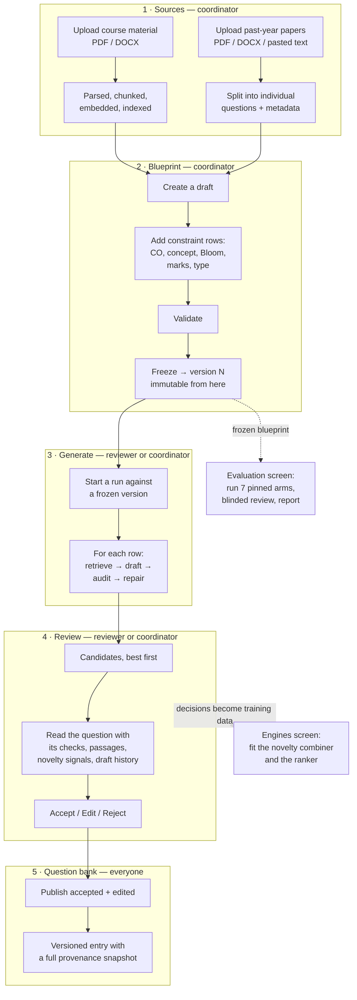

# Complete Project Explanation

**A full walkthrough of the Assessment-Quality Platform: what it is, how it works, and what
happens inside it at every stage.**

---

## 0. How to read this document

This document was written by reading the source code, not the design documents. Where the code
and `plan.md` disagree, the code is described and the difference is pointed out.

Three conventions are used throughout:

| Marker | Meaning |
|---|---|
| **Implemented** | The code exists, is reachable from the interface, and is covered by tests. |
| **Implemented, not exercised in production** | The code exists and passes tests, but has not been run on the live deployment with real data. |
| **NOT IMPLEMENTED** | Does not exist. Named explicitly so nobody builds on an assumption. |

Every technical term is explained the first time it appears, and there is a glossary in
[Appendix E](#appendix-e--glossary).

**Where the real source of truth is:** `plan.md` holds the research design (sections 1–13) and the
agreed future changes (section 14). This document explains the system *as built*.

**One thing to flag immediately.** The task that produced this document asked for an explanation of
"how students interact with the system and receive answers". **There is no student-facing part of
this system.** It is a tool used by faculty — a course coordinator and faculty reviewers — to
produce exam questions. No student logs in, asks anything, or receives an answer. The planned
chatbot module is explicitly untouched (`plan.md` §7.2). See
[Section 6.7](#67-the-student-interaction--not-implemented) for what exists instead and what
building it would take.

---

## Table of contents

1. [Project introduction](#1-project-introduction)
2. [How the project works](#2-how-the-project-works)
3. [Complete technical workflow](#3-complete-technical-workflow)
4. [Novelty and question-generation mechanism](#4-novelty-and-question-generation-mechanism)
5. [System components and their roles](#5-system-components-and-their-roles)
6. [Complete practical example](#6-complete-practical-example)
7. [Implementation status: what is real, what is partial, what is missing](#7-implementation-status)
8. Appendices: [A repository map](#appendix-a--repository-map) · [B database tables](#appendix-b--database-tables) · [C API endpoints](#appendix-c--api-endpoints) · [D configuration](#appendix-d--configuration) · [E glossary](#appendix-e--glossary) · [F running it](#appendix-f--running-it)

---

# 1. Project introduction

## 1.1 What the project is, in one paragraph

It is a web application that **writes exam questions from a course's own teaching material, then
checks them before any human reads them.** A coordinator uploads the course material and the
department's past-year question papers, and writes a *blueprint* — a table saying "question 1 must
test course outcome CO1, on the concept 'TCP congestion control', at Bloom level 'understand', for
5 marks, as a short answer". The system then drafts one question per blueprint row using a large
language model, and subjects each draft to two automatic audits: a **blueprint compliance audit**
(does the question actually match the row it was written for, and is every claim in it traceable to
a real passage in the uploaded material?) and a **novelty audit** (is this question a rewording of
something already asked in a past paper?). Drafts that fail are sent back to the model with the
exact failure named. What survives is ordered by a **ranker** trained on reviewers' own past
accept / edit / reject decisions, shown to a faculty reviewer with all the evidence attached, and —
once accepted — published into a versioned question bank that records exactly how it was produced.

## 1.2 The problem it solves

Setting a good exam paper is slow, and three specific things make it slow:

1. **Blueprint conformance is manual and tedious.** A department paper must cover stated course
   outcomes with a stated distribution of marks and cognitive levels (Bloom's taxonomy: *remember,
   understand, apply, analyze, evaluate, create*). Checking by hand that 10 questions collectively
   satisfy that table is error-prone drudgery.
2. **Accidental repetition.** Questions drift back into papers year after year. Students circulate
   past papers; a repeated question measures memory of the paper, not of the subject. Spotting a
   *reworded* repeat across five years of papers is beyond what anyone does reliably by hand.
3. **Grounding.** A question must be answerable from what was actually taught. A question written
   from general knowledge, or from a topic the lecturer skipped, is unfair.

An off-the-shelf LLM makes all three worse rather than better:

- It will happily invent a plausible-sounding fact that is not in the course material
  ("hallucination"), and it does so fluently enough that a busy reviewer may not notice.
- It has never seen the department's past papers, so it cannot avoid repeating them.
- Asked to check its own work, it tends to agree with itself. Self-grading by the same model that
  wrote the answer is not evidence of anything.

## 1.3 Why this project is needed

Because the valuable part is not the generation — it is the **checking**, and the checking is what
nothing off the shelf does.

Any chat assistant can produce ten exam-looking questions in thirty seconds. What none of them can
tell you is: *which blueprint row does each question satisfy; which page of which uploaded file
supports it; has it been asked before; and how confident should you be in those answers?*

This project's position is that a question generator is only useful in an institution if every
claim it makes about its own output is **independently checkable**. So:

- compliance is decided by **deterministic rules**, not by asking the model;
- novelty is decided by a **small, fitted statistical model over four independent signals**, whose
  per-signal weights are printed on screen;
- grounding is decided by **searching for the model's quote inside the passage it claimed to quote**;
- and the whole system is wrapped in an **evaluation protocol** designed so its own claims can be
  disproved — pinned baselines, blinded review, confidence intervals on every number.

## 1.4 The central idea

> **Generation is cheap. Auditing is the product.**

Everything in the architecture follows from that sentence. The LLM sits behind a swappable adapter
and can be replaced without touching anything else. The three engines around it — compliance,
novelty, ranker — are the contribution, and each is built so that it can be shown to be working or
not working:

| Engine | What it decides | Why it is trustworthy |
|---|---|---|
| **Blueprint compliance** | Does this draft satisfy its constraint row? | Fixed rules in code. Same input, same verdict, every time. No model involved. |
| **Novelty audit** | Is this draft a repeat of a past question? | Four independent signals, combined by a logistic regression fitted on labelled pairs, with a held-out test fold and a published weight per signal. |
| **Reviewer-adapted ranker** | Which draft should the reviewer see first? | Compared against two deliberately simple baselines ("floors"), and it only ships if it beats both. |

## 1.5 How it approaches the problem

Five design commitments, all visible in the code:

1. **The specification is frozen before anything is generated.** A blueprint becomes immutable
   ("frozen") and gets a version number. A generation run points at a frozen version. This means a
   comparison between two runs can never be confounded by someone having edited the specification
   in between. (`routers/blueprints.py:freeze_blueprint`, and `PUT` returns HTTP 409 once frozen.)
2. **The model never judges itself.** `services/compliance.py` contains only regular expressions,
   word counts and set operations.
3. **A failure is named, not just reported.** When a draft fails, the exact violated field is
   written back into the next prompt: *"bloom_level: expected understand; previous draft had
   remember"*. The model gets a correction, not a retry.
4. **Everything is recorded, including the failures.** The first draft's compliance report is kept
   even after a successful repair, so the question "how often is the first draft right?" stays
   answerable after the fact.
5. **Reproducibility is stored per run.** Every run records the backend identity
   (e.g. `groq:openai/gpt-oss-120b`), a SHA-256 hash of the prompt templates, the temperature and
   the random seed. A published question carries all of that in its snapshot.

## 1.6 What this project is *not*

- It is **not a chatbot** and has no conversational interface.
- It is **not a student-facing tool**. See [6.7](#67-the-student-interaction--not-implemented).
- It is **not an exam-conduct system**: it produces the paper, not the sitting, the marking
  or the results.

---

# 2. How the project works

## 2.1 The cast: who can do what

Access is granted twice, by two different people, because the two questions are different.
**Admission** is platform standing (`pending`, `member`, `admin`) and an administrator
decides it. **Membership** is standing on one subject (`reviewer`, `coordinator`) and that
subject's coordinator decides it. An administrator is treated as a coordinator of every
subject, because somebody has to be able to repair one.

```
        signs in with an @thapar.edu Google account
                          │
                          ▼
                   ┌─────────────┐
                   │   pending   │  authenticated, and nothing else
                   └──────┬──────┘
                          │  an administrator admits the account
             ┌────────────┴────────────┐
             ▼                         ▼
      ┌─────────────┐           ┌─────────────┐
      │   member    │           │    admin    │  creates subjects, names
      └──────┬──────┘           └──────┬──────┘  coordinators, admits people
             │                         │
             │  a subject's coordinator adds them to that subject
             ▼                         ▼
   ┌──────────────────┐      ┌──────────────────┐
   │ reviewer on CS301│      │  coordinator of  │   one row per (person, subject)
   │ coordinator on   │      │  every subject   │   in `course_members`
   │ CS503 …          │      │  (admins only)   │
   └──────────────────┘      └──────────────────┘
```
| Role | Can do | Cannot do |
|---|---|---|
| `pending` | Sign in and see "your account is waiting for approval" | Anything else. Every data route returns HTTP 403 `account pending approval`. |
| `reviewer` | Generate candidates, accept/edit/reject, publish, read everything, judge the **blinded evaluation queue** | Upload material or past papers, create/freeze/delete blueprints, fit the engines, launch a study, grant roles |
| `coordinator` | Everything above **except** the blinded queue | Judge the blinded evaluation queue, change their own role |

Two of those exclusions are deliberate and worth understanding:

- **A coordinator is barred from the blinded queue** (`routers/evaluation.py:blinded_queue`
  requires exactly `reviewer`). A coordinator can call `GET /evaluation/candidates/{id}/arm` and
  reveal which system produced a question. Letting the same person judge blinded questions would
  make the blinding unenforceable by the one person able to break it.
- **Nobody can change their own role.** A coordinator who demoted themselves would lock the
  deployment out of its only administrative screen with no way back in
  (`routers/auth.py:set_role`).

Every role change is written to a `role_changes` audit table recording who did it, from what, to
what, and why — including the automatic grant at first sign-in for an address listed in
`COORDINATOR_EMAILS`.

## 2.2 The journey, end to end

The sidebar is the workflow. Five numbered steps, each with a completion tick, plus two analysis
screens and one admin screen.



## 2.3 Step by step: what the user does and what they see

### Step 0 — Signing in

Anybody can open the site; only an `@thapar.edu` Google account can sign in. The landing page
explains what the system does and offers one button: *"Continue with your Thapar account"*.

After Google, three outcomes:

- **Address listed in `COORDINATOR_EMAILS`** → account created with role `coordinator`, straight
  into the app.
- **Any other `@thapar.edu` address** → account created with role `pending`, and the user sees a
  single card: *"Your account is waiting for approval."*
- **Not an institute account** → Google itself refuses (the consent screen is configured as
  *Internal*), and if anything slipped through, the server re-checks and redirects back with
  `#error=domain`, which the interface renders as *"That account is not an institute account."*

When no identity provider is configured (local development, `DEV_LOGIN=true`), the sign-in page
instead lists three seeded users — one coordinator and two reviewers — and you pick one.

### Step 1 — Sources (coordinator)

Two cards on one screen.

**Card A, course material.** Pick a `.pdf` or `.docx` and upload. The response immediately shows
how many passages ("chunks") were indexed and how many pages they cover, and you can expand any
file to read the first five indexed passages verbatim. That preview exists so that ingestion is
*visibly* real: if the PDF was a scan with no text layer, you see it here rather than discovering it
three steps later when generation produces nonsense.

> Several files at a time. Each gets its own row in a queue, succeeds or fails on its own, and
> is indexed behind the response rather than inside it — so a corrupt file in position four
> does not discard the other eleven, and the tab can be closed. Re-uploading the same bytes is
> recognised and skipped.

**Card B, past-year papers.** Each paper needs a **year** (required, as printed on the paper) and a
label such as *"End Semester 2024"*. You can upload a file or paste the text. The system splits it
into individual questions and shows you every one it extracted, with the marks, question type and
Bloom level it read off. A badge at the top tracks coverage: *"1 year — two or more needed"* turns
into *"2 years of coverage"*, because a novelty engine with one year of papers cannot tell you much.

If nothing could be extracted, the upload is rejected with HTTP 422 and the paper is deleted rather
than stored empty — with the advice to paste the questions instead.

### Step 2 — Blueprint (coordinator)

A blueprint is a table. Each row is one question you want, described by five fields:

| Field | Meaning | Allowed values |
|---|---|---|
| `course_outcome` | The stated outcome this question tests | free text, e.g. *"CO1 Explain transport-layer congestion control"* |
| `concept` | The specific topic | free text, e.g. *"TCP congestion control"* |
| `bloom_level` | Cognitive level | `remember`, `understand`, `apply`, `analyze`, `evaluate`, `create` |
| `marks` | Mark weighting | integer ≥ 1 |
| `question_type` | Form of the question | `mcq`, `short_answer`, `long_answer`, `numerical` |

The lifecycle is **draft → validate → freeze**:

- A *draft* is fully editable; rows can be added, changed, reordered or removed, and a draft can be
  discarded entirely.
- *Validate* reports the total marks and the marks allocated per course outcome, and refuses a
  blueprint with no rows at all.
- *Freeze* refuses if validation fails. On success the blueprint gets the next version number for
  that course and a `frozen_at` timestamp. From that moment it is immutable: editing returns 409,
  deleting returns 409.

> A sixth field, `target_difficulty`, was removed on 14 November 2026 (`plan.md` §14.7):
> difficulty is subjective, and Bloom level, marks and question type already carry the intent
> and are checkable. Editing a *frozen* blueprint into a new version remains an agreed future
> change (`plan.md` §14.5).

### Step 3 — Generate (reviewer or coordinator)

Pick a frozen version, press *Start generation run*. The screen tells you exactly what is about to
happen for every row — retrieve, draft, audit, repair — and then shows a live progress bar
(`3 of 10 drafted and audited`), polling every four seconds. You can close the page; the work runs
server-side.

The run table underneath records, per run: when it started, status, how many of how many rows were
drafted, which model backend was used, and the reproducibility triple (temperature, seed, first
eight characters of the prompt hash). A failed run shows its error text in place.

### Step 4 — Review (reviewer or coordinator)

A two-pane workbench. Left: the list of candidates for the run, each with a state dot and a
one-line preview, filterable by *All / To decide / Failed / Dupes*. Right: the selected candidate
in five tabs:

| Tab | What it shows |
|---|---|
| **Question** | The stem, the options if it is an MCQ, and the answer key |
| **Checks** | Every compliance check that ran, pass or fail, with *expected* vs *found* on a failure |
| **Passages** | Each cited passage with its page reference, a support meter, and **the model's quote highlighted inside the passage text** — or a red badge *"quoted text not found here"* if the quote was fabricated |
| **Novelty** | The duplicate probability against the threshold, the four signal values with the fitted weight of each, and the nearest past question with the paper it came from |
| **Drafts** | Every compliance report for this question, first draft through repairs — so you can see what was wrong initially and what the repair fixed |

The decision bar offers **Accept**, **Edit** and **Reject**. An edit requires a changed stem (the
system computes a normalised Levenshtein edit distance from the original). A reject requires a
written reason, which is stored for the failure analysis. Keyboard shortcuts: `J`/`K` to move,
`A` accept, `E` edit, `R` reject, `?` for help. After each decision the cursor jumps to the next
undecided candidate.

A decision can be changed until the question is published.

### Step 5 — Question bank (everyone)

Published questions, newest first. Each entry can be expanded to show its full provenance snapshot:
the published text, the original text if it was edited, the constraint row it was written for, the
blueprint version, the run's model and seed, every citation with its page reference and support
score, the compliance result, and the review decision with its edit distance.

## 2.4 The two analysis screens

### Engines

Where the coordinator fits the two learned models. It is laid out as a sequence of gated stages,
each refusing to run until the previous one has enough data:

1. **Past-year corpus** — blocked at zero papers.
2. **Labelled pair set** — build duplicate/non-duplicate pairs from the corpus; shows the
   composition of the train/validation/test folds; can export the split manifest.
3. **Fitted combiner** — fit the novelty combiner. Refuses with a plain reason below 10 training
   and 5 validation pairs. Shows the fitted weight per signal.
4. **Held-out evaluation** — score the fitted combiner on the test fold and compare it against the
   single-embedding-threshold baseline it is supposed to beat. Every access to the test fold is
   counted and reported, because the protocol reserves it for one evaluation.
5. **Reviewer-adapted ranker** — fit it, and see the comparison against both floors with which
   model actually shipped.

### Evaluation

Where a research study is run: pick arms, pick a seed count, launch. Then the blinded review queue,
then the report. Described in [3.16](#316-the-evaluation-harness).

---

# 3. Complete technical workflow

This section follows the data, not the screens. Everything here was read off the implementation.

## 3.1 The request path, and how authentication actually works

```
Browser (React SPA, Cloudflare Worker)
   │  fetch(API_BASE + path, Authorization: Bearer <token>)
   ▼
FastAPI  ──► CORSMiddleware (exact allow-list: localhost:5173 + FRONTEND_URL)
   │
   ├─ /auth/*            open (sign-in itself cannot require being signed in)
   │
   └─ every other router  Depends(require_active)
         │  1. header must start with "Bearer "
         │  2. itsdangerous signature valid and under 12 hours old
         │  3. user_id resolves to a real row
         │  4. role is not "pending"
         ▼
      router-level role check: require_role("coordinator") etc.
         ▼
      SQLAlchemy Session (pool_pre_ping=True) ──► PostgreSQL + pgvector
```

**Sign-in, in detail** (`routers/auth.py`). Google Workspace is an OIDC provider, so the standard
*authorization-code flow* is used:

1. `GET /auth/login` builds the authorization URL. It generates a random value, **signs it** with
   `itsdangerous` as the CSRF `state`, and adds `hd=thapar.edu` so Google's own account picker only
   offers institute accounts. The state is signed here rather than letting the OAuth library
   generate its own, because the URL must carry **exactly one** `state` parameter — two copies make
   it ambiguous which value is supposed to come back. (There is a regression test for this: it
   would have broken every sign-in.)
2. Google sends the browser to `GET /auth/callback`. Three checks happen server-side, none of them
   trusting the request:
   - the `state` must verify against this service's signing key and be under ten minutes old;
   - `email_verified` must be true — an unverified address proves nothing;
   - the address must end in `@thapar.edu` **and** the `hd` claim must agree. (`hd` on the
     authorization URL only filters Google's UI; it is not a security control, so the claim is
     re-checked.)
3. The user row is found or created. A brand-new address gets role `coordinator` if it is listed in
   `COORDINATOR_EMAILS`, else `pending`. Either way a `role_changes` row records why.
4. The browser is redirected to `{FRONTEND_URL}/#token=...`. **The token travels in the URL
   fragment, not the query string**, because fragments are never sent to servers — so the session
   token stays out of access logs, proxy logs and the `Referer` header. The React app reads it once
   and immediately wipes it from the address bar with `history.replaceState`.

The session token itself is not a JWT; it is an `itsdangerous` signed payload containing the user
id, valid for 12 hours, stored in `localStorage`.

## 3.2 Course material ingestion: from a PDF to searchable passages

`routers/materials.py:upload_material` → `services/ingestion.py:ingest`

This is the stage most people assume is trivial and is not. Course material is usually slide decks,
and slide decks break every assumption a text pipeline makes.

**Step 1 — store.** The file is written to `STORAGE_DIR/{course_id}/{uuid}.{ext}` under a fresh
UUID, not its original name, and a `materials` row records the original filename, type and path.

**Step 2 — extract text, page by page.** `pypdf` for PDFs, `python-docx` for Word.

**Step 3 — repair the lines** (`_lines`). This is where slide decks are handled:

- bullet glyphs (`•`, `▪`, `●`, `■`, and the replacement character that Wingdings exports become)
  are treated as line breaks;
- a leading dash used as a bullet marker is stripped;
- runs of whitespace collapse to one space;
- **a line beginning with a lowercase letter, where the previous line did not end in `.!?:`, is
  joined onto the previous line.** This un-wraps text that the PDF broke mid-sentence.

**Step 4 — drop boilerplate.** For documents of four or more pages, any line appearing on at least
half the pages is removed. That is how running headers, footers and "Department of CSE" on every
slide get out of the index. Without it, those lines dominate the retrieval results.

**Step 5 — split into sentences.** On terminal punctuation followed by whitespace and a capital,
digit or opening bracket. Fragments of three characters or fewer are discarded. Each sentence
carries its page reference: `p1`, `p2`, … for PDFs; `para1`, `para2`, … for Word, because DOCX has
no fixed pagination and the paragraph index is the only stable locator.

**Step 6 — build overlapping windows.** Sentences are grouped into **windows of 5 sentences
advanced 3 at a time** (`CHUNK_WINDOW_SENTENCES=5`, `CHUNK_STRIDE_SENTENCES=3`). The overlap matters:
a window boundary that falls in the middle of an explanation would make that explanation
unretrievable, and the 2-sentence overlap means every sentence appears in two windows. A window
spanning pages 3 to 5 gets the page reference `p3-p5`.

**Step 7 — embed.** Each window's text becomes a **384-dimensional embedding** — a list of 384
numbers positioning the text in a space where "similar meaning" means "close together".

The embedding model is `all-MiniLM-L6-v2`, the standard sentence-transformers model, but run
through **ONNX Runtime with a HuggingFace tokenizer instead of PyTorch**
(`services/embeddings.py`). The pipeline reproduces exactly what sentence-transformers does for
this model: run the transformer, **mean-pool** the token vectors under the attention mask (so
padding does not contribute), then **L2-normalise** (scale to unit length). Normalising has a
useful consequence used all over the codebase: for unit vectors, the **dot product *is* the cosine
similarity**, so similarity is a single multiply-and-sum with no division.

Why avoid PyTorch: it removes about 2.5 GB of dependencies, the process starts in under a second
instead of tens of seconds, it fits inside the 512 MB of the free hosting tier, and every native
binary in the stack stays signed — which Windows Application Control requires on the development
machine. Texts are truncated at 256 tokens, the model's maximum, and embedded in batches of 32.

**Step 8 — store.** One `chunks` row per window: text, page reference, and the embedding in a
pgvector `VECTOR(384)` column.

> This runs **inside the HTTP request**. A large file therefore blocks that request until it is
> done. Moving ingestion to a background job is an agreed future change (`plan.md` §14.2).

## 3.3 Past-year paper ingestion: from an exam paper to a corpus of questions

`routers/pyqs.py` → `services/pyq_ingestion.py`

This is a different problem from material ingestion. There, the goal was *passages to retrieve*;
here, the goal is *individual questions to compare against*, each with its marks, type and Bloom
level. The quality of this corpus is the ground truth that every reported duplicate-detection
number rests on, so the splitter is **rule-based, not model-driven** — a deterministic splitter can
be read, reviewed and argued with.

**Reading the text.** Same line repair as material ingestion, plus one extra rule for PDFs: **a
line consisting of just the page's own number is dropped, checked against the page it appears on.**
That sounds fussy until you see why it is necessary — see the grid layout below.

**Detecting the year.** The first 30 lines are searched for a four-digit year
(`19[89]x` or `20xx`). The result is stored in `pyq_papers.detected_year` and shown next to the
year the coordinator typed. It is **advisory only** and never overrules the entered value — but the
year a paper belongs to is the single fact an uploader is most likely to get wrong, and a corpus
that all looks like one year defeats the entire point of comparing across years.

**Splitting.** Two strategies, tried in order.

**Strategy 1 — the institutional grid layout.** Many departments set papers as a table:

```
┌────────┬────────────────────────────────────────────┬───────┬─────┬────┐
│ Q No.  │ Questions                                  │ Marks │ CO  │ BL │
├────────┼────────────────────────────────────────────┼───────┼─────┼────┤
│ Q1     │ Explain how TCP congestion control …       │   5   │ CO1 │ L2 │
│ Q2a    │ Given the case study above, calculate …    │   4   │ CO2 │ L3 │
│ Q2b    │ … and justify your choice of window size.  │   6   │ CO2 │ L5 │
└────────┴────────────────────────────────────────────┴───────┴─────┴────┘
```

Extracting text from such a PDF **flattens the table**. The marks, CO and BL cells arrive as their
own short lines, interleaved anywhere inside the question they belong to. Splitting on general
numbering then mistakes those cells, the header row, and any numbered list inside a question body
for question boundaries. Recognising the layout is the difference between a corpus of questions and
a corpus of fragments — in testing, a real paper produced 14 fragments with 0 marks before this was
added.

The grid handler:

- finds the header row by matching *Questions … Marks … CO … BL* on one line; everything above it is
  front matter and is discarded;
- starts a new question on `Q1`, `Q5.`, or `Q2a` — note the sub-part letter can follow the number
  with **no separator at all**, and missing that case merges a question into the one before it;
- joins `Q2a` and `Q2b` into **one** question, because on the paper they share a single case study
  and are numbered once;
- recognises a line that is nothing but table cells, and tolerates what OCR does to that column:
  `CO5` prints as `C05`, and `L1` as `L I`, `Ll` or `LJ`;
- **sums** the marks cells across sub-parts, since each sub-part is marked separately;
- takes the Bloom level from the paper's own `L1`–`L6` cell (`L1`→remember … `L6`→create), because
  the level the paper assigns is better evidence than a cue verb in the stem; it falls back to the
  cue-verb classifier only when there is no cell.

The page-number rule from earlier matters here: in this layout a page number is a bare number alone
on a line, which is **indistinguishable from a marks cell**. Counting one inflates the paper's total
marks. Removing it per page, against the page it appeared on, resolves the ambiguity without
throwing away real marks.

**Strategy 2 — general numbering.** If no grid header is found, questions are split on
line-initial numbering: `1.`, `1)`, `Q1`, `Q.1`, `1 a)`, `(a)`, `iii)`. The sub-part letter must
carry its own bracket or dot, otherwise the first letter of the question itself gets read as one.
Marks are then stripped out of the text by pattern (`[5]`, `(5 marks)`, `- 5 marks`) and kept
separately. If no numbering is recognised at all, blank-line-separated blocks are treated as
questions — which is the documented format for the paste-as-text path.

**Metadata per question.**

- `marks` — from the grid cell, or parsed out of the text.
- `question_type` — `mcq` if three or more option markers like `(a) …` appear; `numerical` if a
  numeric cue verb (*calculate, compute, determine, find, how many*) appears **and** the text
  contains a digit; `long_answer` if marks ≥ 6; else `short_answer`.
- `bloom_level` — the paper's own `L` cell, or the cue-verb classifier
  (see [3.9](#39-the-blueprint-compliance-engine)).

**Finally**, every question is embedded with the same model as the course material and stored in
`pyqs`. Blocks of fewer than four words are discarded as headers, instructions or page furniture.
If the splitter produces nothing, the whole paper is deleted and the request fails with 422.

**Deleting a paper** nulls the references to its questions from `duplicate_pairs` and
`novelty_reports` rather than cascading. The labelled pairs keep their text, so correcting a
mis-extracted paper can never silently invalidate a fold assignment.

> **A syllabus is read for its course outcomes.** The coordinator uploads it, a rule-based
> extractor reads the outcomes out of it, and nothing is stored until they have checked what it
> found. The outcomes then belong to the subject, and a blueprint row chooses one from a dropdown
> instead of repeating it as free text. The extractor matches a `CO1`-style label anywhere in the
> document rather than only at the start of a line, because text pulled out of a PDF does not keep
> the line breaks the page showed.
>
> **There is still no unit or topic detection.** Nothing identifies which unit a passage belongs
> to. "Topic" enters the system exactly once: as the `concept` text the coordinator types into a
> blueprint row, which is then used as the retrieval query. That is the whole mechanism.

## 3.4 The blueprint lifecycle

| Action | Endpoint | Rule enforced |
|---|---|---|
| Create draft | `POST /courses/{id}/blueprints` | coordinator only |
| Replace all rows | `PUT /blueprints/{id}/constraints` | 409 if frozen; rows are re-created with `position` 0..n so order is explicit and stable |
| Validate | `POST /blueprints/{id}/validate` | reports total marks and marks per course outcome; refuses a blueprint with no rows |
| Discard draft | `DELETE /blueprints/{id}` | 409 if frozen — published questions and runs reference it, so deleting would orphan the provenance the bank depends on |
| Freeze | `POST /blueprints/{id}/freeze` | 422 if validation fails; 409 if already frozen; assigns `version = max(version for this course) + 1` and `frozen_at` |

`position` is not cosmetic. It is the stable identity of a row for pairing in the evaluation: two
different arms are comparable precisely when they answered **the same constraint under the same
seed**.

## 3.5 A generation run, instruction by instruction

`routers/runs.py:generate` → `services/orchestrator.py`

```
POST /blueprints/{id}/generate   (reviewer or coordinator; 409 unless frozen)
   │
   ├─ start_run():
   │     backend_id   = get_adapter().backend_id      ← resolved NOW, pinned for the run
   │     prompt_hash  = sha256(all four prompt templates)
   │     temperature  = 0.7           seed = random 31-bit integer
   │     status       = "running"
   │
   ├─ returns HTTP 202 immediately with the run row
   │
   └─ BackgroundTasks → execute_run(run_id)   [own DB session]
         │
         ├─ build the novelty corpus ONCE for the whole run
         │     (all PYQs of the course + BM25 statistics + the fitted combiner)
         │     if the corpus is empty → corpus = None, and every candidate records that
         │
         └─ for each constraint row, in position order:
                _generate_for_constraint(...)
```

And for one constraint row:

```
 ┌─ attempt 0 ──────────────────────────────────────────────────────────────┐
 │  retrieve passages        (top 5 by cosine similarity, see 3.6)          │
 │  build the prompt         (constraint + type rules + passages, see 3.7)  │
 │  adapter.generate(...)    → JSON {stem, answer_key, options, citations}  │
 │  attach citations         → support scores, verbatim check (see 3.8)     │
 │  compliance.check(...)    → 6 checks (5 for MCQ), report stored (3.9)    │
 └──────────────────────────────────────────────────────────────────────────┘
             │
    not compliant? ──yes──► state = "violating"; if repairs_used < 2:
             │                  repairs_used++; loop with the violations named
             no                 else: stop here, shown to the reviewer as-is
             ▼
    novelty.audit(...)  → probability, nearest past question, 4 signals (3.11)
             │
    is a duplicate? ──yes──► state = "duplicate"; if redrafts_used < 1:
             │                  redrafts_used++; loop with the nearest question quoted
             no                 else: stop here, shown as a flagged duplicate
             ▼
      state = "novel"   → this is what a reviewer should normally see
```

The attempt budget is `1 + repair_budget(2) + novelty_redraft_budget(1) = 4` LLM calls maximum per
question for the full system.

Four details worth knowing:

1. **The backend is pinned at `start_run`.** Every subsequent draft resolves the adapter from the
   stored `backend_id`. A run that started on the self-hosted model therefore **fails** rather than
   silently continuing on a hosted one if the machine is switched off mid-run — because half a run
   written by one model and half by another produces candidates that are not comparable with each
   other.
2. **Both audits always run, whatever the arm.** What an arm controls is whether a *failure* sends
   the draft back. An arm with enforcement off still gets its compliance rate and duplicate rate
   measured — that measurement is what the ablation comparison is made of.
3. **State is committed after every attempt**, so the progress bar is truthful and a crash leaves
   the completed questions intact.
4. **A failing run is recorded, not swallowed.** The exception type and message land in
   `generation_runs.error` and are rendered in the run table.

## 3.6 Retrieval: finding the right passages

`services/retrieval.py`

The query is built from the constraint row:

```python
query = f"{c.concept}. {c.course_outcome}"
```

It is embedded with the same model as the chunks, and pgvector does the search in the database:

```sql
SELECT chunks.*, chunks.embedding <=> :query_vector AS distance
FROM chunks JOIN materials USING (material_id)
WHERE materials.course_id = :course_id
ORDER BY distance
LIMIT 5
```

`<=>` is pgvector's cosine-distance operator. Cosine **similarity** is reported back as
`1 - distance`. The default `RETRIEVAL_TOP_K` is 5.

This is **Retrieval-Augmented Generation (RAG)**: rather than hoping the model knows the subject,
the relevant passages are found first and pasted into the prompt, and the model is instructed to
use nothing else.

Two alternative grounding modes exist for the research arms: the whole indexed material (capped at
80 chunks) for the "source-grounded tool" baseline, and *no passages at all* for the plain-LLM
baseline, which switches the system prompt to one that tells the model to return an empty citation
list.

## 3.7 Building the prompt

`services/orchestrator.py` holds four templates, and their combined SHA-256 is the `prompt_hash`
recorded on every run — so a run always states exactly which prompts produced it.

**System prompt** (grounded case):

> You are an examination question setter. You write one exam question strictly from the provided
> course passages. Every fact the question relies on must come from the passages. Cite the passages
> you used by their number and quote the exact supporting sentence. Do not invent content that is
> not in the passages.

**User prompt**, assembled from:

```
Blueprint constraint:
- course outcome: CO1 Explain transport-layer congestion control
- concept:        TCP congestion control
- Bloom level:    understand (begin the question with a verb at this level)
- marks:          5
- question type:  short_answer

Type rules: no options; answer expected in a few sentences.

[repair block, only on a repair attempt:]
The previous draft violated the blueprint. Fix every item below:
- bloom_level: expected understand; previous draft had remember
- grounding: expected verbatim quote from a cited passage with support >= 0.25;
             previous draft had no citation with a verbatim quote

[novelty block, only on a novelty redraft:]
The previous draft repeats a question that has already been set in a past paper:
"Explain how TCP congestion control reacts to packet loss…"
Write a different question for the same constraint. Changing only the wording or the
numbers is not enough: ask about a different aspect of the concept.

Course passages:
[1] (p12) TCP interprets packet loss as a signal of congestion…
[2] (p13) During slow start the congestion window doubles each round-trip…
…

Return the question, a complete answer key proportional to the marks, MCQ options only if the
type is mcq (exactly 4, and answer_key must be one of them verbatim), and citations
(passage number + exact quote).
```

The output is constrained by a **JSON schema** — a machine-readable description of the required
shape — so the model must return exactly:

```json
{
  "stem": "...",
  "answer_key": "...",
  "options": ["...", "...", "...", "..."],
  "citations": [{"passage": 1, "quote": "the exact sentence"}]
}
```

`additionalProperties: false` and an explicit `required` list mean a malformed reply fails at the
adapter rather than three layers later.

**The adapters** (`app/llm/`) all implement one method, `generate(GenerationRequest) ->
GenerationResult`:

| Adapter | Backend | Notes |
|---|---|---|
| `ollama` | A local Ollama server, default model `qwen3:8b` | Enforces the JSON schema natively via `format`. `think: false` because reasoning models must emit only the JSON. 900-second timeout: CPU inference can take minutes per draft. |
| `groq` | Groq's OpenAI-compatible API, default `openai/gpt-oss-120b` | Groq accepts a JSON-*object* constraint but not a full schema, so the schema is restated in the system prompt and the parsed object is checked for the required keys. Retries 408/429/5xx with exponential backoff, honouring the `Retry-After` header; does **not** retry 401 or a bad model name. On a rejected model name it calls `/models` and reports which names the key can actually use — because providers retire models on their own schedule and "does not exist or you do not have access" is unhelpful on its own. |
| `anthropic` | Anthropic Messages API | Native JSON-schema output. Sends neither temperature nor seed, and reports both as `None` so the run logs NULL rather than a value the API never used. |
| `failover` | Probe, then choose | `GET {OLLAMA_URL}/api/tags` with a 2-second timeout; if it answers 200, use Ollama, else Groq. The probe catches **every** exception deliberately — a malformed URL raises `httpx.InvalidURL`, which is *not* an `HTTPError`, and catching only the latter left exactly that hole. |

The self-hosted path is reached over a Cloudflare tunnel with **Cloudflare Access** service-token
headers on every call, so the local Ollama server is never an unauthenticated public endpoint.

`GenerationResult` reports what the backend **actually honoured** for temperature and seed, so the
run record never claims a parameter that was ignored.

## 3.8 Citations and grounding

`services/orchestrator.py:_attach_citations`

For each citation the model returned:

1. Resolve `passage` (a 1-based index) back to the actual chunk. An out-of-range index is dropped.
2. **Search for the quote inside that chunk's text.** If found, store the character span
   (`"418:502"`); if not, store the literal string `"not_found"`.
3. Compute `support_score` = cosine similarity between the full drafted question (stem + answer key)
   and the chunk's text.
4. `best_support` = the highest support score **among citations whose quote was found verbatim**.

Point 4 is the whole mechanism. A quote that is not actually present in the passage it claims to
come from **does not count as grounding at all**, no matter how similar the passage is. That is how
a fabricated citation is caught, and it is checkable by anyone: the review screen highlights the
quote inside the passage, or shows a red *"quoted text not found here"* badge.

On a repair, citations are deleted and re-created, so they always describe the current draft.

## 3.9 The blueprint compliance engine

`services/compliance.py` — about 150 lines of rules, no model, no network. Six checks (five for an
MCQ, because the marks check does not apply when the answer key is a single option):

| # | Check | Rule |
|---|---|---|
| 1 | `bloom_level` | Classify the stem (below) and require an exact match with the constraint |
| 2 | `question_type` | MCQ: exactly 4 options **and** the answer key must be one of them verbatim (or a bare A/B/C/D). Non-MCQ: no options present. `numerical`: digits in **both** the stem and the answer key |
| 3 | `marks` | Answer-key word count must fall in the band for the mark weighting |
| 4 | `concept` | Content words of the constraint's `concept` must appear in the stem or answer |
| 5 | `course_outcome` | Same test against the `course_outcome` text |
| 6 | `grounding` | `best_support` must exist (a verbatim quote) **and** be ≥ `GROUNDING_MIN_SIMILARITY` (0.25) |

`satisfaction_rate = (checks - violations) / checks`, and `is_compliant` is true only when there are
zero violations. Every violation records the field, what was expected, and what was observed —
which is exactly what gets written into the repair prompt.

**The Bloom classifier.** Each level has a list of cue verbs:

```
remember    define, list, name, state, recall, identify, label, recognize, what is, who, when
understand  explain, describe, summarize, interpret, classify, discuss, outline, paraphrase, why
apply       apply, calculate, compute, solve, demonstrate, use, implement, determine, find, execute
analyze     analyze, compare, contrast, differentiate, distinguish, examine, categorize, trace, derive
evaluate    evaluate, justify, critique, assess, judge, argue, defend, recommend, to what extent
create      design, construct, develop, formulate, propose, compose, devise, plan, build, invent
```

Every cue is searched for in the stem; the one appearing **earliest** wins, and a tie at the same
position goes to the **higher** level. The earliest-position rule encodes a real property of exam
questions: the leading imperative is the instruction, and later verbs are usually incidental.
*"Explain how to calculate the window size"* is `understand`, not `apply`.

**The mark bands:**

| Marks | Expected answer-key length |
|---|---|
| 1–2 | 1–80 words |
| 3–5 | 20–250 words |
| 6–10 | 60–600 words |
| above 10 | 200 words or more |

A word count is a proxy, not a measure of quality — but it is a deterministic proxy that catches the
real failure, which is a 2-mark question answered in four paragraphs or a 10-mark question answered
in one line.

**Honest note on checks 4 and 5.** The overlap test is loose by design: content words are
alphabetic tokens of four or more characters that are not stopwords, and a word counts as present
if its **first five characters** appear anywhere in the question or answer. That is crude stemming —
it makes *"congestion"* match *"congested"*, and it will also accept some coincidental matches. It
is a check against a question drifting completely off-concept, not a semantic entailment test.

**Why there is no difficulty check.** There was a sixth constraint field,
`target_difficulty`, and no deterministic rule could read difficulty off a question's text. It
was only ever checked for internal consistency with the Bloom level of the same row, which is a
check on the row rather than on the question. The field was removed on 14 November 2026
(`plan.md` §14.7) and the consistency rule went with it: a check is removed along with the
thing it checked.

## 3.10 The repair loop

On a non-compliant draft, under an arm that enforces compliance:

1. `state = "violating"`, report committed.
2. If the repair budget (2) is not spent, loop with a repair block listing **every** violation as
   `field: expected X; previous draft had Y`.
3. If the budget is spent, stop and show the candidate to the reviewer with its failures visible.

A failed question is never hidden. It is shown, flagged, and sorted below the passing ones — because
a reviewer deciding whether to trust the system needs to see what it could not fix.

Every attempt's report is retained, so **first-draft** compliance (what the model got right
unaided) and **final** compliance (what the loop achieved) are both measurable afterwards. The
`Drafts` tab in the review screen is a direct rendering of that history.

## 3.11 The novelty audit

Covered in depth in [Section 4](#4-novelty-and-question-generation-mechanism). In the pipeline:

1. `build_corpus` is called **once per run**: all of the course's past questions, a BM25 index built
   over them, and the fitted combiner loaded from disk (or the labelled untrained fallback).
2. For each draft, `audit`:
   - deletes any previous novelty report for that question through the ORM, so its signal rows go
     with it (a bulk delete would leave orphans and trip the foreign key);
   - if the corpus is empty, writes a report with probability 0.0 and version
     `"<version> (empty corpus)"` — so a run always states what the engine saw, rather than being
     silently absent;
   - otherwise embeds the stem, scores it against the corpus, and stores the nearest past question,
     the probability, the threshold, the verdict, and all four signal values with the fitted weight
     of each.
3. If it is a duplicate and the arm enforces novelty, one redraft is allowed, with the nearest past
   question quoted in the prompt and an explicit instruction that changing wording or numbers is not
   enough.

## 3.12 Ranking

`services/ranker/__init__.py:order`, called by `GET /runs/{id}/candidates`.

- **No fitted ranker** (the normal state early on): sort by `(constraint.position, state != "novel")`
  — blueprint order, with anything that failed an audit pushed down.
- **Fitted ranker**: score every candidate's 22-feature vector, then sort so that candidates which
  failed an audit come last and, within each group, higher predicted acceptance comes first.

A reviewer is therefore never shown a known-bad question first, whether or not a model has been
fitted.

The feature set (`ranker/features.py`) is written out explicitly rather than generated, under one
rule stated in the module docstring: **every feature must be computable before a reviewer looks at
the question.** Nothing derived from the decision on that question — its acceptance, its edit
distance, its reject reason — may appear. There is a test asserting exactly that. The features are
the compliance outputs (satisfaction rate, compliant flag, repair attempts, violation count), the
novelty outputs (probability, four signals, a flag for whether the audit ran at all), the grounding
outputs (citation count, max and mean support), the constraint attributes (Bloom rank, marks,
one-hot question type) and three surface properties of the question (stem words,
answer words, has options).

Missing evidence is encoded explicitly rather than imputed — `novelty_checked = 0` — so a question
the engine never saw is distinguishable from one it cleared.

## 3.13 Review

`routers/reviews.py:review`

Refuses when the candidate is already `published` or `superseded` (409), or when its run has not
completed (409). Then:

- `accept` → `state = "accepted"`.
- `edit` → requires an `edited_stem` that differs from the original (422 otherwise); stores it with
  a **normalised Levenshtein distance** = edit distance ÷ length of the longer string, in [0, 1].
- `reject` → requires a reason (422 otherwise).

The record also stores `blinded = (candidate.arm_label is not None)`. That is derived server-side
from the candidate, **not** taken from the client: a candidate carrying an arm label can only have
been served through the blinded queue, so the condition is recorded rather than trusted.

A decision can be revised until publication; the summary endpoint always counts the **latest**
decision per candidate.

## 3.14 Publishing

`routers/bank.py:publish`

Only `accepted` or `edited` candidates can be published (409 otherwise). Each becomes a
`question_bank` row with a per-question version number (`max + 1`) and a **snapshot** JSON
containing:

- the published stem (the edited one if it was edited) **and** the original stem;
- the answer key and options;
- the full constraint row;
- the blueprint id, version and freeze time;
- the run: id, backend, prompt hash, temperature, seed, start time;
- every citation: chunk id, source filename, page reference, character span, support score;
- the compliance result: compliant flag, satisfaction rate, repair attempts, every violation;
- the review: record id, reviewer email, decision, edit distance, timestamp.

The candidate's state becomes `published`. A snapshot is a historical record and is never rewritten.

## 3.15 Fitting the models

Both learned models follow the same shape: a strict protocol, refusal when data is insufficient,
and a model card that reports what was actually done.

**Novelty combiner** (`services/novelty/training.py`): fit on the train fold, select the
regularisation strength and the decision threshold on the validation fold, and leave the test fold
alone. `evaluate_test` is a separate endpoint because the test fold is meant to be touched once —
and **every access is appended to the model's record**, so a report can state how many times it
actually was. Refuses below 10 training and 5 validation pairs.

**Ranker** (`services/ranker/training.py`): a more careful protocol, because the data is reviewers'
own decisions and there are never many of them.

- Examples are grouped into **review sittings** — one reviewer working through one run.
- **Leave-one-session-out cross-validation** holds a whole sitting out, so the model is never fitted
  on decisions from the sitting it is being scored on.
- Models are compared on **NDCG@k** (a ranking-quality measure), not classification accuracy,
  because the ranker's claim is about *order*.
- The chronologically last sitting is additionally reported on its own, so temporal leakage is
  impossible for the headline number.
- Three models are fitted: LightGBM, logistic regression, and a `compliance_only` floor that just
  orders by satisfaction rate. **LightGBM ships only if it beats both floors.** Otherwise the
  simpler model ships, and that result is recorded either way.
- Refuses below 20 reviewed candidates across 3 sittings.
- The LightGBM configuration is deliberately tiny — 4 leaves, depth 3, minimum 5 samples per leaf —
  because review records are scarce and an unconstrained booster would simply memorise them.

Both models are stored as **JSON** (the LightGBM booster as its own text format), with the feature
order they were fitted on. Diffable, reviewable, and impossible to confuse with an opaque binary.

## 3.16 The evaluation harness

The research machinery. **Implemented and tested; not yet run as a real study.**

**Seven pinned arms** (`services/evaluation/arms.py`). An arm is a configuration saying which parts
of the pipeline are *enforced*:

| Arm | Kind | Retrieval | Blueprint in prompt | Enforce compliance | Enforce novelty | Rank |
|---|---|---|---|---|---|---|
| `full_system` | system | yes | yes | yes | yes | yes |
| `plain_llm` | baseline | none | no | no | no | no |
| `source_grounded` | baseline | whole material (≤80 chunks) | no | no | no | no |
| `fixed_prompt_rag` | baseline | yes | no | no | no | no |
| `ablation_no_blueprint` | ablation | yes | yes | **no** | yes | yes |
| `ablation_no_novelty` | ablation | yes | yes | yes | **no** | yes |
| `ablation_no_ranker` | ablation | yes | yes | yes | yes | **no** |

All arms share the model, the prompt templates and the corpus, so a comparison isolates the
auditing layers instead of confounding them with a change of model. `fixed_prompt_rag` is the
baseline the headline metric is reported against.

**A study** runs every selected arm once per seed, with the **same seed list across all arms**
(`BASE_SEED = 20260915`, 3 seeds by default). That is what makes a candidate from one arm pair
exactly with another arm's candidate for the same constraint under the same seed — which McNemar's
test requires, and which keeps the comparison from being swamped by generation noise. A study
requires a frozen blueprint.

**The blinded queue** (`GET /evaluation/blueprints/{id}/queue`): every candidate of the study this
reviewer has not yet judged, with `run_id` withheld, shuffled with a seed derived from
`reviewer_id:blueprint_id` so that a page reload keeps the same order instead of re-randomising
mid-sitting. Reviewer-only, for the reason given in [2.1](#21-the-cast-who-can-do-what).

**The report** (`services/evaluation/report.py`) computes, per arm: acceptance without edits
(Wilson interval), first-draft compliance (Wilson + bootstrap on the mean satisfaction rate),
duplicate rate (Wilson), edit distance (bootstrap mean + standard deviation), and acceptance broken
down by seed so generation noise is visible rather than averaged away. Across arms: McNemar's exact
test with its effect size and bootstrap interval, NDCG for the ranker ablation, Cohen's kappa
between reviewers, and a machine-checked verbatim-quote rate plus a random sample of 50 citations
for a human judge.

Four rules are enforced in code (`services/metrics.py`):

1. Confidence intervals come from **10,000 bootstrap resamples of the underlying data**, recomputing
   the statistic each time — never from resampling the statistic. The seed is fixed so an interval is
   reproducible.
2. A proportion gets a **Wilson score interval**, which stays inside [0, 1] at small *n* where the
   normal approximation does not.
3. **No p-value is ever returned without its effect size and interval.**
4. Where the interval on a difference includes zero, the verdict literally says *"no significant
   difference: the interval on the difference includes zero"* rather than claiming an improvement.

---

# 4. Novelty and question-generation mechanism

This is the part of the system with the most machinery behind it, so it gets the most space.

## 4.1 Why one similarity number is not enough

The obvious approach is: embed the new question, embed every past question, and flag it if the
cosine similarity exceeds some threshold. That is the baseline this engine is required to beat, and
it is beaten because of how questions get reused in practice:

| How a question comes back | What it defeats | What catches it |
|---|---|---|
| Same question, new numbers — *"window of 32 KB"* instead of *"64 KB"* | Exact matching; weakens lexical overlap | **numerical** — mask every number and the two become nearly identical |
| Paraphrase — *"Explain how…"* → *"Describe the way in which…"* | Lexical overlap | **semantic** — embeddings are close regardless of wording |
| Same conditions, reordered | Sequence-based comparison | **structural** — clauses compared as an unordered set |
| Same topic, genuinely different question | *Nothing* — and this is the dangerous one, because the embedding alone will call it a duplicate | **lexical + structural** disagree with semantic, and the combiner learns to weigh that disagreement |

The last row is the real argument for four signals. Two questions on TCP congestion control are
semantically close whether or not one is a repeat of the other. A single embedding threshold
therefore has to choose between flagging legitimate new questions and missing real repeats. Four
signals that can *disagree* give the combiner something to work with.

## 4.2 The four signals

Each returns a value in [0, 1], where 1 means "identical on this dimension". Nothing is hand-tuned:
the combiner learns the weights.

### Signal 1 — semantic

```python
def semantic(left_vec, right_vec):
    dot = sum(a * b for a, b in zip(left_vec, right_vec))
    return max(0.0, min(1.0, dot))
```

The dot product of two L2-normalised 384-dimensional embeddings **is** their cosine similarity,
clipped into [0, 1]. Same model as everywhere else in the system.

### Signal 2 — lexical (Okapi BM25)

BM25 is the standard information-retrieval relevance score. Three ideas:

- **IDF (inverse document frequency)** — a term appearing in few documents carries more evidence
  than a common one. *"congestion"* is informative in a networking paper; *"explain"* is not.
- **Term-frequency saturation** — the tenth occurrence of a word adds less than the second.
- **Length normalisation** — a long document should not score highly just for containing more words.

The implementation uses `k1 = 1.5`, `b = 0.75` (the standard defaults) and Robertson/Sparck-Jones
IDF with +0.5 smoothing, floored at zero so a term present in every document cannot contribute
negative evidence.

BM25 is a *ranking* score, not a bounded similarity, so it has to be normalised before it can be a
signal:

```python
lexical = min(1, score(query, document) / score(query, query))
```

Both numerator and denominator use the same IDF weights, so the ratio answers: *how much of the
query's own evidence does this document supply?* The clip is needed because term saturation lets a
short, repetitive document exceed the self-score.

Critically, the document does **not** have to be a corpus member — the corpus only supplies the IDF
weights and the average document length. That is what lets the same statistics score a live
candidate question and a constructed training pair identically.

### Signal 3 — structural

The mean of up to four comparable components, skipping any whose value is unknown on either side
(unknown is skipped, *not* scored as a mismatch):

| Component | Comparison |
|---|---|
| question type | 1.0 if equal, else 0.0 |
| marks | `1 - |a - b| / max(a, b)` — 5 vs 5 → 1.0; 5 vs 4 → 0.8; 5 vs 10 → 0.5 |
| Bloom level | 1.0 if equal, else 0.0 |
| clause set | **Jaccard similarity** of the two clause sets: `|A ∩ B| / |A ∪ B|` |

The clause set is what makes this order-insensitive. The text is split on `;`, `,`, `:`, *and*, *or*
and newlines; each clause is tokenised and normalised into a key; the result is a **set**, so the
same conditions listed in a different order produce the same set.

One subtlety does real work here: **`_trim_common` first strips the wording the two questions share
at each end.** A question's lead-in (*"Design a schema that…"*) binds to whichever condition happens
to come first, so without trimming, the same conditions in a different order yield different first
clauses and the Jaccard score drops. Trimming isolates the part that actually differs. If trimming
would empty either side, the untrimmed texts are used.

### Signal 4 — numerical

```python
left  = tokenize(mask_numbers(left_text),  drop_stopwords=False)
right = tokenize(mask_numbers(right_text), drop_stopwords=False)
return SequenceMatcher(None, left, right, autojunk=False).ratio()
```

Every number is replaced by `#`, and the two token sequences are compared with Python's
`SequenceMatcher` ratio. Stopwords are deliberately **kept** here, because this signal is about
sentence shape rather than content.

> *"Calculate the throughput for a window of 64 KB and an RTT of 40 ms"* and
> *"Calculate the throughput for a window of 32 KB and an RTT of 80 ms"*
> both become
> *"calculate the throughput for a window of # kb and an rtt of # ms"* → ratio **1.000**.

## 4.3 The combiner

`services/novelty/combiner.py`

**Logistic regression** over the four signals. Logistic regression — not a neural network, not a
large ensemble — for three stated reasons: the per-signal weight is directly reportable, it is
stable at the sample sizes this project has, and it is fast enough to run inside the generation
loop.

```
z = intercept + w_semantic·semantic + w_lexical·lexical
              + w_structural·structural + w_numerical·numerical

duplicate_probability = sigmoid(z) = 1 / (1 + e^(-z))

is_duplicate = duplicate_probability >= threshold
```

The fitted model is four coefficients, an intercept and a threshold, stored as JSON.

**Before anything is fitted**, the engine uses a clearly labelled fallback: the **equal-weight mean**
of the four signals (each weight 0.25), with threshold **0.85**, under the version string
`"untrained:equal-weight-mean"`. It is a stand-in so the audit can run before the labelled pair set
exists — and because that version string is written into every report it produces, a result from it
can never be mistaken for a result from a fitted model. The review screen shows the difference
explicitly.

**Fitting** (`fit`): a grid of regularisation strengths `C ∈ {0.01, 0.1, 1, 10, 100}` is tried with
`class_weight="balanced"`; for each, the decision threshold maximising F1 **on the validation fold**
is selected, with ties broken toward higher precision. The precision tie-break is a value judgement
stated in the code: a false positive blocks a genuinely novel question, which costs more than a
missed duplicate that a reviewer may still catch. The grid runs from most to least regularised and
the comparison is strictly greater, so a tie keeps the simplest model.

## 4.4 The shortlist: keeping it affordable

Computing all four signals against every past question for every draft would get slow as the corpus
grows. So `score_against_corpus`:

1. Ranks **all** past questions by embedding dot product — cheap, one multiply-and-sum each, and the
   embeddings are already stored.
2. Takes the top `NOVELTY_SHORTLIST = 10`.
3. Computes all four signals and the duplicate probability for those 10 only.
4. Sorts by probability and takes the highest as the **nearest past question**.

The shortlist is ranked by the one signal that is cheap for every row; the expensive signals only
run on the plausible candidates.

## 4.5 A measured example

The numbers below were **produced by running the project's own code** against a five-question toy
corpus, using the locally fitted combiner. They are real outputs, not illustrations.

The corpus:

```
Q1  Explain how TCP congestion control reacts to packet loss, with reference to the
    slow-start and congestion-avoidance phases.
Q2  Calculate the throughput of a TCP connection with a window of 64 KB and a
    round-trip time of 40 ms.
Q3  Define the term deadlock and list the four Coffman conditions…
Q4  Compare paging with segmentation as memory-management schemes…
Q5  Describe the three-way handshake used by TCP to establish a connection.
```

Three candidate questions, each scored against the corpus. `p_untrained` is the equal-weight mean
(threshold 0.85); `p_fitted` is the locally fitted logistic regression (threshold 0.4881).

**Candidate A — Q2 with the numbers changed** (*"a window of 32 KB and a round-trip time of 80 ms"*):

| compared with | semantic | lexical | structural | numerical | p_untrained | p_fitted |
|---|---|---|---|---|---|---|
| **Q2** | 0.971 | 0.716 | 0.750 | **1.000** | **0.859 → duplicate** | 0.516 → duplicate |
| Q5 | 0.438 | 0.096 | 0.250 | 0.194 | 0.244 | 0.480 |

The numerical signal is exactly 1.000 — masking the numbers makes the two identical — and that is
what pushes the mean over 0.85. Note that the semantic signal alone (0.971) would also have caught
this one.

**Candidate B — Q2 paraphrased, same numbers** (*"Compute the throughput achieved by a TCP
connection whose window is 64 KB when the round-trip time is 40 ms"*):

| compared with | semantic | lexical | structural | numerical | p_untrained | p_fitted |
|---|---|---|---|---|---|---|
| **Q2** | 0.956 | 0.653 | 0.750 | 0.579 | 0.735 → **not** flagged | 0.507 → duplicate |
| Q5 | 0.433 | 0.079 | 0.250 | 0.258 | 0.255 | 0.481 |

This is informative. The paraphrase rearranges the sentence, so the numerical signal falls to 0.579
and the equal-weight mean lands at 0.735 — **below 0.85, so the untrained fallback misses it**. The
fitted combiner flags it. This is precisely why the fallback is labelled a placeholder rather than a
model: equal weights with a hand-picked threshold are not a duplicate detector, and the system says
so on screen.

**Candidate C — a genuinely new question on the same topic** (*"Determine the minimum window size a
TCP connection needs to keep a 100 Mbps link busy when the round-trip time is 20 ms"*):

| compared with | semantic | lexical | structural | numerical | p_untrained | p_fitted |
|---|---|---|---|---|---|---|
| **Q2** | 0.752 | 0.290 | 0.750 | 0.439 | 0.558 → not flagged | 0.495 → **duplicate (wrong)** |
| Q5 | 0.394 | 0.059 | 0.250 | 0.176 | 0.220 | 0.479 |

Read the signals: semantic stays high (0.752 — same topic, same vocabulary) while lexical collapses
to 0.290 and numerical to 0.439. **That disagreement is the signature of a new question on a
familiar topic**, and it is exactly what a single-embedding threshold cannot see. The equal-weight
mean handles it correctly. The locally fitted combiner does not — which brings us to the next
subsection.

## 4.6 An honest limitation you must know about

The combiner artefact currently sitting in `backend/data/models/novelty_combiner.json` (local only —
it is **not** committed to the repository) was fitted on **43 training and 15 validation pairs**,
and selection landed on the most heavily regularised setting, `C = 0.01`. Its coefficients:

```json
"semantic": 0.0515, "lexical": 0.0741, "structural": 0.0259, "numerical": 0.0690
"intercept": -0.1291, "threshold": 0.4881, "metrics": {"validation_f1": 1.0}
```

Because the coefficients sum to only 0.2205, the linear term `z` can only range over
`[-0.1291, +0.0915]` — so **the model's output probability can only ever lie between 0.468 and
0.523**, whatever the input. The threshold, 0.4881, sits inside that 5.5-percentage-point band.
That is why Candidate C above came out at 0.495 and got flagged: the margin between "obvious
duplicate" and "unrelated question" is about four percentage points of probability.

Two conclusions, both important:

1. **The ordering is still sound.** The probability is monotone in a weighted sum of the signals, so
   the *nearest past question* the engine reports — the thing a reviewer actually reads — is
   reliable. It is the absolute duplicate/not-duplicate **line** that is not yet calibrated.
2. **`validation_f1: 1.0` on 15 pairs means nothing.** `combiner.py` says this in its own comments:
   at small sample sizes every value of `C` often ties on validation F1, which makes the selection
   *uninformative rather than wrong* — and the model card reports the chosen `C` and the fold sizes
   precisely so a reader can see when that is the case.

The plan's own target is **300 labelled pairs minimum** (`plan.md` §5), with the sample-size
justification given there. The engine should be treated as structurally complete and numerically
unvalidated until that corpus exists. Nothing in this document, and nothing on the Engines screen,
should be read as a claim that duplicate detection has been demonstrated.

## 4.7 Where the labelled pairs come from

`services/novelty/pairs.py` and `dataset.py`

A combiner needs labelled examples: pairs of questions known to be duplicates and pairs known not to
be. Collecting those by hand is slow, so most are **constructed**, with the label known by
construction.

**Positives** — transform a real past question. The *stratum* records how hard the transform makes
the pair:

| Stratum | Transform | What it does |
|---|---|---|
| `surface` | `prefix` | `"Q7. <question> [5 marks]"` — numbering and mark annotation only |
| `surface` | `whitespace` | reformatting only |
| `hard` | `renumber` | every number changed — the case the numerical signal exists for |
| `hard` | `reorder_clauses` | the same conditions listed in a different order |
| `hard` | `synonyms` | a two-way substitution table: explain↔describe, calculate↔compute, advantages↔benefits… |
| `hard` | `question_form` | imperative ↔ interrogative: *"Explain how X"* → *"How does X? Explain."* |

Hard transforms are preferred; surface ones fill the quota. A transform that cannot apply returns
`None` rather than returning the text unchanged.

**Negatives** — real pairs of different questions:

- **hard negatives** are each question's most semantically similar *other* question. These are what
  stop the task from being solvable by cosine similarity alone.
- **easy negatives** are randomly sampled across topics.

**Deduplication** drops any pair whose two sides are identical after masking numbers and normalising
whitespace (unless the provenance is `renumber`, where that identity is the point), and any pair
whose identity has already been seen.

**Pair identity and the split.** Two functions carry a lot of weight here:

```python
def pair_key(left, right):
    a, b = sorted(normalise(t) for t in (left, right))
    return sha256(f"{a}||{b}").hexdigest()[:32]        # order-independent, machine-independent

def assign_split(key, seed=20260915):
    position = int.from_bytes(sha256(f"{seed}:{key}").digest()[:8], "big") / 2**64
    return "train" if position < 0.60 else "val" if position < 0.80 else "test"
```

The fold a pair lands in is a **pure function of the seed and the pair's own content**. It depends on
nothing else — not on insertion order, not on how many other pairs exist. Consequences:

- Adding pairs later never moves an existing pair between folds, so a test fold cannot be silently
  contaminated by a later import.
- The split can be regenerated on any machine and can only come out the same.
- Stratification is therefore *approximate* rather than exact, which is an accepted trade — and
  `composition()` reports what each fold actually contains so nobody has to assume.
- The split manifest (seed, rule, fold composition, and every pair's fold) is exportable to
  `backend/data/novelty_split.json` to be committed alongside the code.

**Scoring a pair** uses the same statistics a live candidate would get: BM25 IDF and average
document length come from the course's real past-year corpus, and a constructed variant inherits the
metadata of the question it was derived from.

## 4.8 The question-generation mechanism, summarised

Putting [3.5](#35-a-generation-run-instruction-by-instruction)–[3.11](#311-the-novelty-audit)
together, one question is produced like this:

```
constraint row ──► "TCP congestion control. CO1 Explain transport-layer congestion control"
                        │ embed (384-d)
                        ▼
                   pgvector cosine search over this course's chunks → top 5 passages
                        │
                        ▼
      system prompt (write only from these passages, cite with exact quotes)
    + constraint block (CO, concept, Bloom + "begin with a verb at this level", marks, type)
    + type rules
    + [repair block: every violated field, expected vs observed]
    + [novelty block: the past question being repeated, quoted]
    + numbered passages with page references
                        │ JSON-schema-constrained call through the pinned adapter
                        ▼
          {stem, answer_key, options, citations:[{passage, quote}]}
                        │
         ┌──────────────┴──────────────┐
         ▼                             ▼
  verbatim quote search          6 deterministic checks
  + cosine support score         (Bloom, type, marks, concept, outcome, grounding)
         └──────────────┬──────────────┘
                        ▼
              compliant?  ──no──► repair (≤2), violations named
                        │yes
                        ▼
   novelty: embed stem → top-10 shortlist → 4 signals → logistic regression
                        │
              duplicate? ──yes──► redraft (≤1), nearest past question quoted
                        │no
                        ▼
                  state = "novel" → ranked → reviewer
```

---

# 5. System components and their roles

## 5.1 The map

```
┌─────────────────────────────────────────────────────────────────────────────┐
│  BROWSER — React 19 SPA (Vite build, served by a Cloudflare Worker)         │
│  Shell + 8 pages + login · api.js (bearer token) · ui.jsx (design system)           │
└───────────────────────────────┬─────────────────────────────────────────────┘
                                │ HTTPS + JSON, Authorization: Bearer
┌───────────────────────────────▼─────────────────────────────────────────────┐
│  FASTAPI — 9 routers (Docker image on Render)                               │
│  auth · materials · pyqs · blueprints · runs · reviews · bank · novelty ·   │
│  evaluation          ── all but auth gated by require_active                │
├─────────────────────────────────────────────────────────────────────────────┤
│  SERVICES                                                                   │
│  ingestion │ pyq_ingestion │ embeddings │ retrieval │ orchestrator │         │
│  compliance │ novelty/* │ ranker/* │ review │ metrics │ evaluation/*         │
├─────────────────────────────────────────────────────────────────────────────┤
│  LLM ADAPTERS  ollama │ groq │ anthropic │ failover                          │
└───────┬────────────────────────────────────────────┬────────────────────────┘
        │                                            │
┌───────▼──────────────────────┐        ┌────────────▼─────────────────────┐
│ PostgreSQL 18 + pgvector     │        │ Local disk: uploaded files,      │
│ (Neon, serverless)           │        │ ONNX embedder, fitted models     │
│ 20 tables, VECTOR(384)       │        │ (ephemeral in the container)      │
└──────────────────────────────┘        └──────────────────────────────────┘
```

## 5.2 Component by component

### `services/embeddings.py` — the embedder
- **Why it exists:** everything semantic in the system — retrieval, grounding support, the semantic
  signal, hard-negative mining — is a cosine similarity between two embeddings. One module owns the
  model so all of them are in the same vector space.
- **In:** a list of strings. **Out:** a list of 384-float L2-normalised vectors.
- **Processing:** HuggingFace tokenizer (truncate 256) → ONNX Runtime → mean-pool under the
  attention mask → L2-normalise. Batches of 32. The session is built once and cached.
- **Connects to:** ingestion, pyq_ingestion, retrieval, novelty signals, novelty dataset.
- **Note:** the model files must be present under `backend/data/models/all-MiniLM-L6-v2-onnx`, or the
  module raises a message naming the fetch script. The Docker image bakes them in, because the
  container filesystem is not persistent and a cold start would otherwise download 90 MB before
  serving its first request.

### `services/ingestion.py` — course-material ingestion
- **In:** a stored `Material` row. **Out:** `chunks` rows; returns the count.
- **Processing:** parse → line repair → boilerplate removal → sentence split → 5/3 sentence windows
  → embed → insert. Full detail in [3.2](#32-course-material-ingestion-from-a-pdf-to-searchable-passages).
- **Connects to:** `routers/materials.py` (caller), retrieval (consumer).

### `services/pyq_ingestion.py` — past-paper ingestion
- **In:** a stored `PYQPaper` row and the document text. **Out:** `pyqs` rows with marks, type, Bloom
  level and embedding; returns the count.
- **Processing:** page-aware text reading → year detection → grid-layout split, else numbering
  split, else blank-line blocks → metadata inference → embed. Full detail in
  [3.3](#33-past-year-paper-ingestion-from-an-exam-paper-to-a-corpus-of-questions).
- **Connects to:** `routers/pyqs.py`; borrows `_lines` from ingestion and `classify_bloom` from
  compliance; produces the corpus the novelty engine compares against.

### `services/retrieval.py` — vector search
- **In:** course id, query text, `top_k`. **Out:** `(chunk, cosine_similarity)` pairs, most similar
  first. Also `similarity(a, b)` for two strings, used for citation support scores.
- **Processing:** embed the query, let pgvector do the ordering in SQL.

### `services/orchestrator.py` — the generation orchestrator
- **Why it exists:** it is the only place that knows the *order* of the pipeline. Everything else is
  a function it calls.
- **In:** a run id (in a background task). **Out:** candidates, citations, compliance reports,
  violations, novelty reports, and a terminal run status.
- **Processing:** the loop in [3.5](#35-a-generation-run-instruction-by-instruction). Owns the four
  prompt templates, the output JSON schema and the prompt hash.
- **Connects to:** retrieval, the LLM adapters, compliance, novelty, the arms registry.

### `services/compliance.py` — the blueprint compliance engine
- **Why it exists:** to decide compliance without asking a model. Deterministic, reviewable, and
  cheap enough to run on every attempt.
- **In:** a constraint row, the stem, the answer key, the options, the best verbatim support score.
- **Out:** `Report(is_compliant, satisfaction_rate, violations[])`, each violation naming field,
  expected and observed.
- **Also exports:** `classify_bloom` (reused by past-paper ingestion) and `checked_fields` (so the
  interface can render every check that ran, not only the failures).

### `services/novelty/*` — the novelty engine
| File | Role |
|---|---|
| `signals.py` | The four signals and the BM25 index. Pure functions; no database. |
| `combiner.py` | Logistic regression: probability, threshold, fitting, held-out evaluation, the single-signal baseline, JSON persistence, the labelled untrained fallback. |
| `__init__.py` | `build_corpus` (once per run) and `audit` (per draft). Writes the report and its signal breakdown. |
| `pairs.py` | Transforms, negative construction, deduplication, `pair_key`, `assign_split`, `composition`. |
| `dataset.py` | Builds and stores the pair set, exports the split manifest, turns a fold into signal vectors. |
| `training.py` | Fit (train + validation only), held-out evaluation with access counting, the model card. |

### `services/ranker/*` — the reviewer-adapted ranker
| File | Role |
|---|---|
| `features.py` | The explicit 22-feature list, the leakage rule, `extract`, `decision_of`, `session_of` |
| `models.py` | `ComplianceOnlyRanker`, `LinearRanker`, `BoostedRanker`, JSON load/save, the two fit functions |
| `training.py` | Leave-one-session-out cross-validation, NDCG comparison, the "beat both floors" selection rule, the model card |
| `__init__.py` | `order(candidates)` — what the review screen actually calls |

### `services/metrics.py` — statistics
Bootstrap confidence intervals (10,000 resamples, fixed seed), Wilson score intervals,
precision/recall/F1/confusion, exact McNemar with effect size, Cohen's kappa, NDCG@k. Used by both
training pipelines and the evaluation report. An undefined statistic serialises as `null`, never
`NaN` — which is not valid JSON and would read as a real zero.

### `services/evaluation/*` — the research harness
`arms.py` (seven pinned configurations), `harness.py` (launch, study status, shared seed lists),
`report.py` (every reported number with its interval, and verdict wording that refuses to overclaim).

### `app/llm/*` — the backend adapters
One abstract method, four implementations, one failover resolver. The orchestrator depends only on
the interface, which is what makes "the same pipeline on a different model" a configuration change
rather than a code change.

### `app/models.py`, `app/db.py` — persistence
20 SQLAlchemy tables ([Appendix B](#appendix-b--database-tables)). `db.py` creates the `vector`
extension, creates missing tables, and applies a short list of idempotent
`ALTER TABLE … ADD COLUMN IF NOT EXISTS` statements at startup — a deliberate stand-in for a
migration tool while the schema is small, with a comment saying to move to Alembic once the
evaluation data matters. `pool_pre_ping=True` and `pool_recycle=300` are not optional against a
serverless Postgres that scales to zero: it drops idle connections when it suspends, so a pooled
connection that looked fine at checkout is already dead.

### `app/auth.py`, `app/routers/auth.py` — identity
Session token issue/verify, `require_role`, `require_active`; the OIDC flow, the people list and
role granting. See [3.1](#31-the-request-path-and-how-authentication-actually-works).

### `frontend/src/*` — the interface
| File | Role |
|---|---|
| `App.jsx` | Session bootstrap, the pending-approval screen, page routing, workflow progress ticks, the waiting-for-a-role count |
| `api.js` | One `fetch` wrapper; attaches the bearer token; carries HTTP status on errors so "no role yet" reads differently from "not allowed" |
| `components/Shell.jsx` | Sidebar (workflow + analysis + admin), topbar, mobile drawer |
| `components/ui.jsx` | The design system: Card, Badge, Btn, Stat, Table, Tabs, Note, Empty, Explainer, Toast, Segmented, Progress, Meter, Kbd, `useShortcuts` |
| `components/Candidate.jsx` | The five-tab candidate view and the decision bar, including the quote-highlighted passage |
| `pages/*` | Login, Materials, Blueprints, Generate, Review, Bank, Engines, Evaluation, People |
| `index.css` | ~600 lines: design tokens, light/dark, the app shell, and breakpoints at 1180 / 1000 / 720 / 560 px |

---

# 6. Complete practical example

A single realistic pass through the system. Where an exact value depends on the model, it is marked
as illustrative; the mechanism around it is exactly what the code does.

## 6.1 Setting up the course

Dr. Mehta coordinates **UCS503 Computer Networks**. The deployment is configured with
`COURSE_CODE=UCS503`, `COURSE_TITLE=Computer Networks`, and her address in `COORDINATOR_EMAILS`. She
signs in with Google and lands straight in the app as a coordinator.

> **There is no syllabus-parsing step.** Course outcomes are not extracted from anything; she will
> type them into blueprint rows herself (see `plan.md` §14.6 for the agreed change).

## 6.2 Step 1 — Sources

**Course material.** She uploads `unit3-transport-layer.pdf`, 28 slides. Internally:

```
28 pages → extract text → line repair (bullets, wrapped lines rejoined)
         → "Department of CSE, TIET" appears on 26 of 28 pages → removed as boilerplate
         → 212 sentences, each tagged p1 … p28
         → windows of 5, stride 3 → 70 chunks, page refs like "p11-p12"
         → 70 embeddings (384-d) → 70 chunks rows
```

The card reports **70 passages across 28 pages**, and she expands it to read the first five. They
are readable prose about transport-layer protocols, so the PDF had a real text layer and ingestion
worked. (On the live deployment, a real upload produced 42 passages — the figure depends entirely on
the document.)

**Past papers.** She adds two:

- `Year 2024`, label *"End Semester 2024"* — a PDF in the institutional grid layout. The splitter
  finds the `Q No. | Questions | Marks | CO | BL` header, discards the front matter above it, starts
  a question at each `Q1`…`Q8`, joins `Q6a` and `Q6b` into one question, sums their marks cells, and
  reads the Bloom level from the `L2`/`L3` column. Result: **8 questions**, with marks and Bloom
  levels.
- `Year 2025`, label *"MST 2025"* — another PDF. `detect_year` finds "2025" in the header and agrees
  with what she typed, so no mismatch badge appears.

The badge turns to **"2 years of coverage"**. She expands both papers and reads every extracted
question to confirm the split is clean — the screen exists for exactly this, because this corpus is
the ground truth the novelty engine will compare against.

## 6.3 Step 2 — The blueprint

She creates a draft and enters three rows:

| # | course_outcome | concept | bloom | marks | type |
|---|---|---|---|---|---|
| 1 | CO1 Explain transport-layer congestion control | TCP congestion control | understand | 5 | short_answer |
| 2 | CO2 Apply window-sizing calculations | TCP throughput and window size | apply | 5 | numerical |
| 3 | CO3 Analyse connection management | TCP three-way handshake | analyze | 10 | long_answer |

**Validate** returns:

```json
{"ok": true, "issues": [], "total_marks": 20,
 "outcomes": {"CO1 Explain transport-layer congestion control": 5,
              "CO2 Apply window-sizing calculations": 5,
              "CO3 Analyse connection management": 10}}
```

Had she tried to freeze while the blueprint still had no rows, validation would have reported
`blueprint has no constraints` and **Freeze** would have returned 422. With validation clean, **Freeze** assigns **version 1** and a
timestamp. From this moment the three rows cannot be changed, and `PUT` on them returns 409.

## 6.4 Step 3 — The generation run

Prof. Rao, a reviewer, selects version 1 and presses *Start generation run*. The run row is created
immediately:

```
backend_id   groq:openai/gpt-oss-120b     (failover probed the tunnel; the lab machine was off)
prompt_hash  8f3c1a2e…                    (sha256 of all four templates)
temperature  0.7      seed  1472839006    status  running
```

### Row 1, attempt 0

**Retrieve.** Query `"TCP congestion control. CO1 Explain transport-layer congestion control"` →
embedded → pgvector returns the 5 nearest chunks, e.g. `p11` (sim 0.71), `p12-p13` (0.68),
`p11-p12` (0.66), `p14` (0.59), `p10` (0.55).

**Draft.** The prompt carries the constraint, the short-answer type rule, and the five numbered
passages. The model returns (illustrative):

```json
{
  "stem": "List the phases of TCP congestion control.",
  "answer_key": "Slow start, congestion avoidance, fast retransmit and fast recovery.",
  "options": [],
  "citations": [{"passage": 2, "quote": "TCP congestion control proceeds in phases"}]
}
```

**Citations.** Passage 2 is the `p12-p13` chunk. The quote *"TCP congestion control proceeds in
phases"* is searched for inside that chunk's text — **not found**, so the span is recorded as
`"not_found"`. The support score (cosine between the question and the chunk) is still computed and
stored at 0.62, but because the quote is not verbatim, `best_support` is `None`.

**Compliance.** Six checks:

| check | verdict |
|---|---|
| bloom_level | **FAIL** — expected `understand`; the earliest cue in the stem is *"list"* → observed `remember` |
| question_type | pass — no options, and the type is `short_answer` |
| marks | pass — 9 words, inside the 20–250 band? **No** — 9 < 20 → **FAIL** |
| concept | pass — *"conges…"* appears |
| course_outcome | pass |
| grounding | **FAIL** — `best_support` is `None` → *"no citation with a verbatim quote"* |

`satisfaction_rate = 3/6 = 0.5`, `is_compliant = false`. The candidate's state becomes `violating`,
the report and its three violations are stored, and the loop continues.

### Row 1, attempt 1 (repair)

The same prompt, plus:

```
The previous draft violated the blueprint. Fix every item below:
- bloom_level: expected understand; previous draft had remember
- marks: expected 5 marks -> answer of 20-250 words; previous draft had 9 words
- grounding: expected verbatim quote from a cited passage with support >= 0.25;
             previous draft had no citation with a verbatim quote
```

The model returns a stem beginning *"Explain how…"*, a four-sentence answer key of about 70 words,
and a citation quoting a sentence that genuinely appears in passage 2. Now:

- bloom_level: *"explain"* at position 0 → `understand` → pass
- marks: 70 words, inside 20–250 → pass
- grounding: the quote is found at characters 418–502; support 0.68 ≥ 0.25 → pass

All six pass. `satisfaction_rate = 1.0`, `repair_attempts = 1`. **Both compliance reports are kept.**

**Novelty.** The stem is embedded and ranked against the 2024 + 2025 corpus. The top shortlist entry
is 2024's Q1, *"Explain how TCP congestion control reacts to packet loss…"* — same topic, same
leading verb. Signals (illustrative, in the shape the real engine produces):
`semantic 0.81, lexical 0.34, structural 0.75, numerical 0.46`. Under the untrained fallback the
equal-weight mean is 0.59, below the 0.85 threshold → **not a duplicate**. State becomes `novel`.

The lexical and numerical signals disagreeing with the semantic one is exactly the pattern described
in [4.5](#45-a-measured-example): same topic, different question.

### Rows 2 and 3

Row 2 is `numerical`, so the type check additionally requires digits in both the stem and the answer
key. Suppose the first draft is a well-formed numerical question but the novelty audit puts it at
0.89 against 2025's *"Calculate the throughput of a TCP connection with a window of 64 KB…"* — the
numerical signal is near 1.0 because only the numbers were changed. State becomes `duplicate`, and
the single redraft fires with:

```
The previous draft repeats a question that has already been set in a past paper:
"Calculate the throughput of a TCP connection with a window of 64 KB and a round-trip time of 40 ms."
Write a different question for the same constraint. Changing only the wording or the numbers is not
enough: ask about a different aspect of the concept.
```

The redraft asks instead for the *minimum window size needed to saturate a link* — the same concept,
a different question — and clears both audits.

Row 3 passes on its first draft. `run.status = "completed"`.

> Observed on the live deployment: one candidate passed all six checks on its first draft, and in a
> separate run a fabricated citation was caught exactly as described above — `span = not_found`
> among three verbatim ones. The novelty engine identified Q4 of the 2025 MST as nearest with
> p = 0.404.

## 6.5 Step 4 — Review

Prof. Rao opens Review. No ranker is fitted yet, so the order is blueprint position with audit
failures pushed down.

He selects the row-1 candidate and works through the tabs:

- **Question** — the stem and the 70-word answer key.
- **Checks** — six green rows.
- **Passages** — passage `p12-p13` with the model's quote highlighted in place, and a support meter
  at 0.68.
- **Novelty** — "not a duplicate", 0.59 against a threshold of 0.85, the four signals with no
  weights shown (because the combiner is unfitted — the screen says so), and 2024's Q1 as the
  nearest past question.
- **Drafts** — two reports: the first with three red failures, the second all green. He can see
  exactly what the repair loop fixed.

He changes "packet loss" to "a lost packet" and presses **Edit**. The server stores the edited stem
and a normalised edit distance of about 0.04, and the state becomes `edited`. The cursor jumps to
the next undecided candidate.

He accepts row 2 unchanged and rejects row 3 with the reason *"the handshake diagram was not covered
in class this semester"* — stored, and read back during the failure analysis.

The run summary now reads: total 3, accepted 1, edited 1, rejected 1, pending 0, mean edit
distance 0.04.

## 6.6 Step 5 — Publish

He presses *Publish*, which sends the accepted and edited candidates. Each becomes a bank entry at
version 1 with a snapshot containing the published stem, the original stem, the constraint row,
blueprint version 1 and its freeze time, the run's backend / prompt hash / temperature / seed, every
citation with its page reference and support score, the full compliance result, and his own decision
with its edit distance. Both candidates move to state `published`, and a second publish attempt
returns 409.

Months later, anyone can open that entry and answer: which blueprint row was this for, which file
and page supports it, which model and seed produced it, what the checker said, who approved it, and
what they changed.

## 6.7 The student interaction — NOT IMPLEMENTED

> **This is the one part of the requested explanation that cannot be written, because the
> functionality does not exist.**

There is **no student-facing interface, no query intake, no answering mechanism, and no chatbot** in
this codebase. Specifically:

- No student role exists. Platform standing is `pending`, `member` or `admin`, and standing on
  a subject is `reviewer` or `coordinator`. None of them is a student.
- Sign-in is restricted to institute Google accounts and every account lands on `pending` until a
  coordinator grants a faculty role. A student signing in would see the "waiting for approval"
  screen forever.
- No endpoint accepts a free-text question from a user. The only free text a user submits is an
  edited stem, a reject reason, or a pasted past paper.
- `grep` for *student*, *chatbot* or *chat* across the whole backend and frontend returns exactly
  one hit: the words "student" and "students" in the compliance engine's **stopword list**.
- `plan.md` §7.2 lists the chatbot module as **"untouched. It remains secondary."**

**What does exist that a student-facing feature could be built on**, if the team decides to:

| Existing piece | How it would serve a student-facing feature |
|---|---|
| `services/embeddings.py` | Embed a student's question |
| `services/retrieval.py` | Find the passages that answer it, with page references |
| `app/llm/*` | Draft an answer from those passages only |
| `_attach_citations` logic | Verify that the answer's quotes genuinely appear in the cited passages before showing it |
| `question_bank` | Serve published questions as practice material |

In other words the retrieval-and-grounding half of a trustworthy question-answering feature is
already built and tested; what is missing is a student role, an intake endpoint, an answer-shaped
prompt and a student interface. **Nobody should plan around this as if it exists.**

---

# 7. Implementation status

## 7.1 Verified on the live deployment

| Thing | Evidence |
|---|---|
| Institutional Google sign-in, `@thapar.edu` only | Signing in with a non-institute account is refused by Google's Internal consent screen; the server re-checks domain, `hd` and `email_verified` |
| Every data route refuses an anonymous request | 401 on all of them; CORS allow-list exact |
| Course-material ingestion | A real PDF indexed to 42 passages inside the 512 MB tier |
| Past-paper ingestion, grid layout | 11 questions across 2024 and 2025, with marks and Bloom levels |
| Generation end to end | One candidate passing 6/6 checks on its first draft |
| Grounding verification | A fabricated citation caught — `span = not_found` among three verbatim quotes |
| Novelty audit | Nearest past question correctly identified (Q4 of the 2025 MST, p = 0.404) |
| Role request flow | An unlisted institute address arrived as `pending`, and the grant was recorded in `role_changes` |

## 7.2 Implemented and tested, but not yet exercised in production

88 tests pass against a real PostgreSQL + pgvector database (only the LLM is stubbed). These paths
are covered by tests but have not been run on the live deployment with real data:

- the compliance repair loop end to end;
- the novelty redraft;
- publishing to the question bank;
- labelled pair construction, split assignment and the split manifest;
- combiner fitting and held-out evaluation;
- the ranker: feature extraction, leave-one-session-out cross-validation, the "beat both floors"
  rule, and candidates coming back in the learned order;
- the evaluation harness: launching arms, the blinded queue, the full report;
- the Ollama / self-hosted path over the Cloudflare tunnel;
- DOCX ingestion and the paste-as-text past-paper route.

## 7.3 Known limitations

| Limitation | Detail |
|---|---|
| **The fitted novelty combiner is not calibrated** | 43 train + 15 validation pairs, `C = 0.01`; its probability can only range over [0.468, 0.523] with a threshold of 0.4881 inside that band. Ordering is sound; the duplicate/not-duplicate line is not. See [4.6](#46-an-honest-limitation-you-must-know-about). The plan's floor is 300 pairs. |
| **No ranker has been fitted** | Needs 20 reviewed candidates across 3 review sittings. Until then, candidates are ordered by blueprint position with audit failures last. |
| **Concept and outcome checks are loose** | First-five-character prefix matching of content words — crude stemming, not semantic entailment. |
| **Schema changes are an ad-hoc patch list** | Three idempotent `ALTER TABLE` statements at startup instead of a migration tool. The code says to move to Alembic once the evaluation data matters. |
| **Uploaded files are not durable on the free tier** | The container filesystem is ephemeral; the database rows survive a restart, the original PDFs may not. |

## 7.4 What changed on 14 November 2026

All seven changes specified in `plan.md` §14 are now implemented, in the order that section fixed.
Each one is recorded there with what was built and where the implementation departed from the
specification.

| § | Change | What it means in the app |
|---|---|---|
| 14.7 | `target_difficulty` removed | A blueprint row has five fields. The difficulty↔Bloom rule and one ranker feature went with it |
| 14.1 | Multiple subjects | A `course_members` row decides what you may do to a subject; `users.role` keeps only platform standing. Objects of a subject you are not in answer 404, not 403 |
| 14.6 | Syllabus → course outcomes | A rule-based extractor reads them out, the coordinator checks them before anything is stored, and a blueprint row chooses one from a dropdown |
| 14.5 | Revising a frozen blueprint | `POST /blueprints/{id}/revise` copies it into a draft. The frozen version is never edited |
| 14.2 | Multi-file upload | A batch, one result row per file, indexed behind the response through `ingestion_jobs` |
| 14.4 | Optional suggestion | Free text per run, folded into `prompt_hash`, unable to loosen the blueprint, excluded from studies |
| 14.3 | Paper assembly and PDF | Published questions bound into a numbered paper, checked against the blueprint total, printed server-side with ReportLab. The answer key is a separate coordinator-only download |

## 7.5 Still not implemented

| Missing | Where it stands |
|---|---|
| **Any student-facing feature** — student role, query intake, answering, chatbot | Untouched and secondary in the plan (`plan.md` §7.2). See [6.7](#67-the-student-interaction--not-implemented) |
| **Unit or topic detection** | Not planned as such. "Topic" is the concept text typed into a blueprint row |
| **An executed evaluation study** | The harness exists; no study has been run with real reviewers |
| **A fitted ranker** | Needs 20 reviewed candidates across 3 review sittings |
| **A calibrated novelty combiner** | Needs the 300 labelled pairs `plan.md` §5 asks for; see [4.6](#46-an-honest-limitation-you-must-know-about) |
| **Alembic** | The schema is still a list of idempotent statements run at startup. The code says to move once the evaluation data matters |

---

# Appendix A — Repository map

```
plan.md                          Research design (§1-13) + agreed changes (§14)
README.md                        Setup, run, deploy
Complete_Project_Explanation.md  This document
Dockerfile                       Backend image; port from $PORT; embedder baked in
render.yaml                      Render blueprint; every secret sync:false
wrangler.jsonc                   Cloudflare Worker, assets-only, SPA fallback

backend/
  app/
    main.py                  App assembly, CORS, seed, the require_active gate
    config.py                All settings, with the psycopg3 URL normaliser
    db.py                    Engine, session, vector extension, schema patches
    auth.py                  Session tokens, require_role, require_active
    models.py                20 ORM tables
    schemas.py               Pydantic request/response models
    routers/                 auth bank blueprints evaluation materials novelty pyqs reviews runs
    llm/                     base __init__ ollama_adapter groq_adapter anthropic_adapter failover
    services/
      ingestion.py           PDF/DOCX -> chunks
      pyq_ingestion.py       Past paper -> questions + metadata
      embeddings.py          ONNX MiniLM, 384-d, L2-normalised
      retrieval.py           pgvector search
      orchestrator.py        The generation loop + prompts + output schema
      compliance.py          The six deterministic checks + Bloom classifier
      review.py              Levenshtein + normalised edit distance
      metrics.py             Bootstrap, Wilson, McNemar, kappa, NDCG
      novelty/               signals combiner pairs dataset training __init__
      ranker/                features models training __init__
      evaluation/            arms harness report
  scripts/fetch_embedding_model.py
  tests/                     88 tests against a real PostgreSQL + pgvector database
  data/models/               ONNX embedder, fitted combiner, fitted ranker (untracked)

frontend/
  src/App.jsx api.js format.js index.css
  src/components/            Shell Candidate ui Icon Stats
  src/pages/                 Login Materials Blueprints Generate Review Bank Engines Evaluation People
```

# Appendix B — Database tables

| Table | Holds |
|---|---|
| `users` | email, name, platform standing (`pending` / `member` / `admin`) |
| `course_members` | who holds `reviewer` or `coordinator` on which subject, granted by whom |
| `course_outcomes` | code, text, position, source filename, extractor confidence |
| `ingestion_jobs` | one uploaded file's progress: state, detail, chunk count |
| `paper_templates` | institution, department, examination, duration, instructions |
| `papers` / `paper_items` | an assembled paper and the published questions on it |
| `role_changes` | Every role a user has held, who granted it, from what, to what, why, when |
| `courses` | code, title |
| `materials` | Uploaded course files: filename, type, stored path |
| `chunks` | Indexed passages: text, page_ref, `VECTOR(384)` embedding |
| `blueprints` | course, version (at freeze), created_at, frozen_at |
| `blueprint_constraints` | position, course_outcome, concept, bloom_level, marks, question_type |
| `generation_runs` | blueprint, backend_id, prompt_hash, temperature, seed, status, error, arm_label |
| `candidate_questions` | run, constraint, arm_label, stem, answer_key, options, state, repair_attempts |
| `grounding_citations` | question, chunk, char_span (or `not_found`), support_score |
| `compliance_reports` | question, is_compliant, satisfaction_rate, created_at |
| `constraint_violations` | report, field, expected, observed |
| `review_records` | question, reviewer, decision, edited_stem, edit_distance, reason, blinded |
| `question_bank` | question, version, snapshot (JSONB), published_at |
| `pyq_papers` | course, year, detected_year, label, filename, source_type, stored_path |
| `pyqs` | paper, number, text, marks, question_type, bloom_level, `VECTOR(384)` embedding |
| `novelty_reports` | question, nearest_pyq, duplicate_probability, threshold, is_duplicate, model_version |
| `novelty_signals` | report, name, value, weight |
| `duplicate_pairs` | pair_key, both texts, label, stratum, provenance, split, verified_by |
| `model_versions` | kind (novelty / ranker), algorithm, version, params, metrics, artifact_path, is_active |

Candidate states: `drafted` → `violating` / `duplicate` / `novel` → `accepted` / `edited` /
`rejected` → `published`.

# Appendix C — API endpoints

Every route except `/auth/*` requires a signed-in user with a granted role.

| Method & path | Role | Purpose |
|---|---|---|
| `GET /auth/login` | — | Start the OIDC flow |
| `GET /auth/callback` | — | Finish it; redirect with the token in the fragment |
| `POST /auth/login` | — | Development sign-in by email (only when no IdP is configured) |
| `GET /auth/me` | any | The signed-in user |
| `GET /auth/users` | — | Seeded users, development only |
| `GET /auth/people` | coordinator | Everyone who has signed in, and how they got their role |
| `POST /auth/people/{id}/role` | coordinator | Grant or revoke a role |
| `GET /courses` | active | The course list |
| `POST /courses/{id}/materials` | coordinator | Upload and ingest course material |
| `GET /courses/{id}/materials` | active | Material list with chunk and page counts |
| `GET /materials/{id}/chunks` | active | Preview indexed passages |
| `POST /courses/{id}/pyq-papers` | coordinator | Upload a past paper (file) |
| `POST /courses/{id}/pyq-papers/text` | coordinator | Paste a past paper as text |
| `GET /courses/{id}/pyq-papers` | active | Paper list with question counts |
| `GET /pyq-papers/{id}/questions` | active | Extracted questions |
| `DELETE /pyq-papers/{id}` | coordinator | Remove a mis-extracted paper |
| `POST /courses/{id}/blueprints` | coordinator | Create a draft |
| `PUT /blueprints/{id}/constraints` | coordinator | Replace the rows (409 if frozen) |
| `POST /blueprints/{id}/validate` | active | Totals, coverage, inconsistencies |
| `POST /blueprints/{id}/freeze` | coordinator | Assign a version; make immutable |
| `DELETE /blueprints/{id}` | coordinator | Discard a draft (409 if frozen) |
| `POST /blueprints/{id}/generate` | reviewer / coordinator | Start a run (202) |
| `GET /blueprints/{id}/runs`, `GET /runs/{id}` | active | Run list and status |
| `GET /runs/{id}/candidates` | active | Candidates, ranked |
| `GET /candidates/{id}/evidence` | active | Citations and every compliance report |
| `POST /candidates/{id}/review` | reviewer / coordinator | Accept / edit / reject |
| `GET /runs/{id}/reviews` | active | Decision summary |
| `POST /candidates/publish` | reviewer / coordinator | Publish to the bank |
| `GET /bank/entries`, `GET /bank/entries/{id}` | active | Published entries with provenance |
| `POST /courses/{id}/novelty/pairs` | coordinator | Build labelled pairs |
| `GET /novelty/pairs`, `GET /novelty/pairs/list` | active | Fold composition and pair rows |
| `POST /novelty/pairs/export` | coordinator | Write the split manifest |
| `POST /courses/{id}/novelty/train` | coordinator | Fit the combiner (train + validation only) |
| `POST /courses/{id}/novelty/evaluate-test` | coordinator | Held-out evaluation; counts accesses |
| `GET /novelty/model` | active | Combiner model card |
| `POST /courses/{id}/ranker/train` | coordinator | Fit and compare against both floors |
| `GET /ranker/model` | active | Ranker model card |
| `GET /evaluation/arms` | active | The seven pinned configurations |
| `POST /evaluation/blueprints/{id}/study` | coordinator | Launch arms × seeds |
| `GET /evaluation/blueprints/{id}/study` | active | Study progress per arm |
| `GET /evaluation/blueprints/{id}/queue` | **reviewer only** | Blinded review queue |
| `GET /evaluation/blueprints/{id}/report` | active | Every metric with its interval |
| `GET /evaluation/candidates/{id}/arm` | coordinator | Reveal which arm wrote a question |

# Appendix D — Configuration

Set in `backend/.env` locally, or as environment variables in the deployment.

| Variable | Default | Meaning |
|---|---|---|
| `DATABASE_URL` | local postgres | Normalised to `postgresql+psycopg://` automatically, so a provider's string can be pasted as given |
| `STORAGE_DIR` | `../storage` | Where uploads land (`/app/storage` in Docker) |
| `SESSION_SECRET` | `change-me` | Signs session tokens and the OAuth state |
| `FRONTEND_URL` | `http://localhost:5173` | Where the callback returns the browser; also a CORS origin |
| `OIDC_ISSUER` / `_CLIENT_ID` / `_CLIENT_SECRET` / `_REDIRECT_URI` | — | Google OIDC |
| `DEV_LOGIN` | `true` | Email sign-in and seeded users. **Must be `false` in a deployment** |
| `COURSE_CODE` / `COURSE_TITLE` | `CS101` / `Prototype Course` | The single course, seeded at startup |
| `ALLOWED_DOMAIN` | — | e.g. `thapar.edu` |
| `ALLOWED_EMAILS` | — | Comma-separated exceptions to the domain rule |
| `COORDINATOR_EMAILS` | — | Addresses granted `coordinator` at first sign-in |
| `CHUNK_WINDOW_SENTENCES` / `_STRIDE_` | 5 / 3 | Chunk size and overlap |
| `LLM_BACKEND` | `ollama` | `ollama` / `anthropic` / `groq` / `failover` |
| `OLLAMA_MODEL` / `_URL` / `_TIMEOUT` | `qwen3:8b` / localhost / 900 s | Self-hosted backend |
| `GROQ_API_KEY` / `_MODEL` / `_MAX_RETRIES` | — / `openai/gpt-oss-120b` / 4 | Hosted fallback |
| `CF_ACCESS_CLIENT_ID` / `_SECRET` | — | Cloudflare Access service token for the tunnel |
| `GENERATION_TEMPERATURE` | 0.7 | Logged per run; honoured only by backends that accept it |
| `RETRIEVAL_TOP_K` | 5 | Passages per constraint |
| `REPAIR_BUDGET` | 2 | Compliance repairs per question |
| `GROUNDING_MIN_SIMILARITY` | 0.25 | Support floor for the grounding check |
| `NOVELTY_ENABLED` / `_SHORTLIST` / `_REDRAFT_BUDGET` | true / 10 / 1 | Novelty audit |
| `SOURCE_GROUNDED_MAX_CHUNKS` | 80 | Cap for the whole-material baseline's prompt |

# Appendix E — Glossary

| Term | Meaning |
|---|---|
| **Blueprint** | The table specifying the questions a paper must contain: outcome, concept, Bloom level, marks and type per row |
| **Constraint** | One row of a blueprint; one question is generated per row |
| **Frozen** | A blueprint that has been versioned and made immutable; only frozen blueprints can be generated from |
| **CO (course outcome)** | A stated learning outcome of the course, which questions are mapped to |
| **Bloom's taxonomy** | Six cognitive levels: remember, understand, apply, analyze, evaluate, create |
| **LLM** | Large language model — the text generator behind an adapter |
| **Adapter** | A small class exposing one `generate` method, so the model can be swapped without touching the pipeline |
| **Prompt** | The instructions sent to the model: a system prompt (role and rules) plus a user prompt (this task) |
| **JSON schema** | A machine-readable description of the required reply shape, enforced by the model or checked on arrival |
| **Temperature** | How random the model's output is; 0 is deterministic, higher is more varied |
| **Seed** | A number fixing the random choices, so a run can be repeated |
| **Embedding** | A list of numbers (here 384) representing a text's meaning; similar texts get nearby vectors |
| **L2-normalised** | Scaled to unit length, which makes the dot product equal to the cosine similarity |
| **Cosine similarity** | How aligned two vectors are: 1 identical direction, 0 unrelated |
| **pgvector** | The PostgreSQL extension that stores vectors and searches them by distance |
| **Chunk / passage** | One indexed window of course material, with a page reference |
| **RAG** | Retrieval-Augmented Generation: find relevant passages first, then generate only from them |
| **Grounding** | Whether a question's claims come from a real cited passage |
| **Verbatim check** | Searching for the model's quote inside the passage it claimed to quote |
| **Support score** | Cosine similarity between a drafted question and a cited passage |
| **Hallucination** | A fluent, plausible claim the model invented |
| **PYQ** | Past-year question |
| **BM25** | A standard relevance score combining term rarity, term-frequency saturation and length normalisation |
| **IDF** | Inverse document frequency: rarer terms carry more evidence |
| **Jaccard similarity** | Overlap of two sets: intersection ÷ union |
| **Logistic regression** | A model producing a probability from a weighted sum of inputs through a sigmoid |
| **Sigmoid** | `1 / (1 + e^-z)`, which squashes any number into (0, 1) |
| **Threshold** | The probability above which a draft is called a duplicate |
| **Precision / recall / F1** | Of what was flagged, how much was right / of what should have been flagged, how much was / their harmonic mean |
| **Train / validation / test fold** | Data used for fitting / for choosing settings / reserved for the one reported evaluation |
| **Hard negative** | A non-duplicate pair that looks like a duplicate — what makes the task non-trivial |
| **Levenshtein distance** | The number of single-character edits between two strings; normalised here by the longer length |
| **LightGBM** | A gradient-boosted decision-tree library |
| **Floor / baseline** | A deliberately simple model a proposed model must beat to justify itself |
| **NDCG@k** | A ranking-quality measure rewarding relevant items placed near the top |
| **Bootstrap confidence interval** | Resample the data 10,000 times, recompute the statistic, take the middle 95% |
| **Wilson score interval** | A confidence interval for a proportion that stays inside [0, 1] at small sample sizes |
| **McNemar's test** | A test for two systems judged on the same paired items |
| **Cohen's kappa** | Agreement between two raters, corrected for agreement by chance |
| **Arm** | One pinned configuration in a study: a baseline, an ablation, or the full system |
| **Ablation** | Removing one component to measure what it contributed |
| **Blinding** | Hiding which system produced a question so the reviewer cannot favour one |
| **OIDC** | OpenID Connect; the identity protocol Google Workspace sign-in uses |
| **CSRF state** | A signed one-time value proving a sign-in callback belongs to a request this server started |
| **URL fragment** | The part after `#`, never sent to a server — which is why the session token travels there |

# Appendix F — Running it

**Prerequisites:** PostgreSQL 18 with pgvector, Python 3.14, Node 24, and either Ollama with a
pulled model or a Groq / Anthropic API key.

```powershell
# one-time
copy .env.example backend\.env
cd backend
python -m venv .venv
.\.venv\Scripts\activate
pip install -r requirements.txt
python scripts\fetch_embedding_model.py     # ~90 MB ONNX embedder into data/models/
cd ..\frontend
npm install
psql -U postgres -c "CREATE DATABASE aqp"
psql -U postgres -c "CREATE DATABASE aqp_test"

# every time — terminal 1
cd backend; .\.venv\Scripts\activate; uvicorn app.main:app --reload --port 8000

# every time — terminal 2
cd frontend; npm run dev
```

The app is then at `http://localhost:5173`, the API at `http://localhost:8000`, and the interactive
API docs at `http://localhost:8000/docs`. Tables, the `vector` extension, the course and the seeded
users are all created on first start.

**Tests:**

```powershell
cd backend; .\.venv\Scripts\activate; python -m pytest -q
```

88 tests, against a real `aqp_test` database. Only the LLM is stubbed, so ingestion, vector search
and every table write are genuinely exercised.

**Deployment** (as currently live): the backend as a Docker web service on Render's free tier,
PostgreSQL on Neon (serverless, scales to zero), the built frontend on an assets-only Cloudflare
Worker, generation on Groq with failover to a self-hosted Ollama over a Cloudflare tunnel, and
Google Workspace sign-in restricted to one domain. `README.md` has the click-by-click steps.

---

*Written by reading the source. Where this document and the code disagree, the code is right —
please correct this file.*
