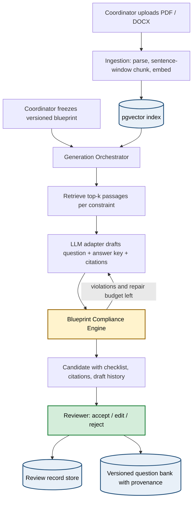

<p align="center">
  <h1 align="center">Assessment-Quality Platform</h1>
  <p align="center">
    <strong>Blueprint-compliant, source-grounded exam question generation with a rule-based audit layer and a fully provenanced question bank.</strong>
  </p>
  <p align="center">
    
    
    
    
    
  </p>
</p>

---

## Overview

Faculty set exam papers by hand. Each question must map to a course outcome, sit at the right Bloom level, carry the right marks, be answerable from what was taught, and not repeat past papers — and today all of that is verified from memory.

Generic AI tools (ChatGPT, NotebookLM, plain RAG) write fluent questions but guarantee none of those properties. They do not check a blueprint, do not cite the taught material, and do not learn from reviewer decisions.

This platform generates questions **under explicit constraints** and **audits every draft before a human sees it**. A coordinator freezes a versioned blueprint; the system retrieves passages from the uploaded course material, drafts a candidate through a swappable LLM backend, runs a deterministic compliance engine against every blueprint field, repairs failing drafts, and presents the survivors to reviewers with citations, page references and a pass/fail checklist. Every reviewer decision is recorded, and every published question carries full provenance.

> **Key differentiator:** the LLM never grades its own output. Compliance is rule-based and auditable, grounding is verified verbatim against the source, and the model's sampling parameters, prompt hash and seed are logged per run so results are reproducible.

This repository is the **prototype** (plan §7): the document-to-question vertical slice on one course. The novelty engine, learned ranker and evaluation harness are specified in [`plan.md`](plan.md) and build on the same pipeline.

---

## System Architecture



### Compliance and grounding

Each draft is checked against the blueprint row it was generated for. Every check is a fixed rule over the text:

| Check | Rule |
|---|---|
| `bloom_level` | Keyword/structure Bloom classifier on the stem (earliest cue verb wins) must equal the constraint level |
| `question_type` | MCQ needs exactly 4 options with the answer among them; non-MCQ must have none; numerical needs numbers in stem and answer |
| `marks` | Answer-key word count must fall in the band for the mark weighting |
| `concept` / `course_outcome` | Content words of the constraint must appear in the question or answer |
| `grounding` | At least one citation whose quoted text is **verbatim** in the cited passage and whose support score clears the floor |

Reported per draft as

$$\text{satisfaction rate} = \frac{\text{checks passed}}{\text{checks run}}$$

and for edited questions

$$\text{edit distance} = \frac{\text{Levenshtein}(\text{original}, \text{edited})}{\max(|\text{original}|, |\text{edited}|)}$$

The first-draft report is preserved even after repairs, so the pre-repair constraint satisfaction rate (plan §3.3.6) is measurable.

---

## Results

Prototype run on real course material — a 26-page *Data Flow Diagrams* slide deck — against a frozen 6-row blueprint spanning two course outcomes, Bloom levels *remember → evaluate*, and short-answer / long-answer / MCQ types. Backend `ollama:qwen3:8b` on CPU, temperature 0.7, seed logged.

| Metric | Value |
|---|---|
| Passages indexed / pages covered | 42 / 26 of 26 |
| Candidates generated | 6 (one per blueprint row) |
| LLM drafts including repairs | 10 |
| Compliant on first draft | 4 / 6 |
| Compliant after repair budget (2) | 4 / 6 |
| Violations caught | `bloom_level` ×2, `marks` ×1, `grounding` ×1 (non-verbatim quote) |
| Wall-clock | 6 min 40 s |

One of the two remaining `bloom_level` failures is a **false alarm** — "Balance the following DFD…" is a legitimate apply-level verb that the cue list does not contain — which is exactly the failure mode the plan's qualitative analysis section (§13.2) anticipates. The rule set was deliberately not tuned after seeing this output.

These are figures from a single run with six questions; they demonstrate that the pipeline is real and that the audit catches violations, not a statistical claim. The evaluation protocol (baselines, ablations, blinded reviewers, bootstrap intervals) is defined in `plan.md` §3.3 and is not run in the prototype.

End-to-end test (`backend/tests/test_e2e.py`) exercises upload → blueprint → generate → audit → repair → review → publish against a real Postgres/pgvector database with a stubbed LLM: **passing**.

---

## Innovation Layer

| Component | What It Does | File |
|---|---|---|
| **Blueprint Compliance Engine** | Six deterministic checks per draft, violations named by field / expected / observed; repair loop re-prompts the model with the exact failures. The model never grades itself. | `backend/app/services/compliance.py` |
| **Verified Grounding** | Retrieval from the coordinator's own material via pgvector; each citation stores the chunk, the quoted character span and a cosine support score. A paraphrased or invented quote does not count. | `backend/app/services/retrieval.py`, `orchestrator.py` |
| **Slide-aware Ingestion** | Sentence-window chunking that treats bullets and line breaks as boundaries, re-joins wrapped lines and drops repeated footers, so citations resolve to the right page even for slide decks. | `backend/app/services/ingestion.py` |
| **Swappable LLM Backend** | One adapter interface; self-hosted Ollama (temperature and seed honoured) and hosted Anthropic implementations. Backend id, prompt hash, temperature and seed are logged per run. | `backend/app/llm/` |
| **Reviewer Record Store** | Every accept / edit / reject stored with reviewer, edited text, normalised edit distance and reason — the training data for the reviewer-adapted ranker (plan §3.1). | `backend/app/routers/reviews.py` |
| **Provenanced Question Bank** | Publishing snapshots the question with blueprint version, run, citations, compliance report and review decision; re-publishing creates a new version. | `backend/app/routers/bank.py` |

---

## Repository Structure

```text
├── plan.md                          # Full project plan: scope, evaluation protocol, schema, roadmap
├── .env.example                     # Configuration template (copy to backend/.env)
├── backend/
│   ├── requirements.txt
│   ├── app/
│   │   ├── main.py                  # FastAPI app, startup (tables + seed course/users)
│   │   ├── config.py                # Settings (database, LLM backend, retrieval, repair budget)
│   │   ├── models.py                # Tables from plan.md §8
│   │   ├── schemas.py               # API request/response models
│   │   ├── auth.py                  # Session tokens and role checks
│   │   ├── routers/                 # Endpoints from plan.md §9
│   │   │   ├── auth.py              #   OIDC login / dev login
│   │   │   ├── materials.py         #   upload & ingest, passage preview
│   │   │   ├── blueprints.py        #   draft, constraints, validate, freeze
│   │   │   ├── runs.py              #   generate, run status, candidates, evidence
│   │   │   ├── reviews.py           #   accept / edit / reject, summary
│   │   │   └── bank.py              #   publish, bank listing with provenance
│   │   ├── services/
│   │   │   ├── ingestion.py         #   PDF/DOCX -> sentence windows -> embeddings
│   │   │   ├── embeddings.py        #   sentence-transformers (all-MiniLM-L6-v2, 384-d)
│   │   │   ├── retrieval.py         #   pgvector similarity search
│   │   │   ├── compliance.py        #   rule-based blueprint checks + Bloom classifier
│   │   │   ├── orchestrator.py      #   retrieve -> draft -> audit -> repair
│   │   │   └── review.py            #   normalised Levenshtein distance
│   │   └── llm/
│   │       ├── base.py              #   adapter interface
│   │       ├── ollama_adapter.py    #   self-hosted open-weight backend
│   │       └── anthropic_adapter.py #   hosted backend
│   └── tests/test_e2e.py            # End-to-end journey against real Postgres
├── frontend/                        # React (Vite) — five-step guided UI
│   └── src/
│       ├── App.jsx                  # Step bar and navigation
│       ├── pages/                   # Materials, Blueprints, Generate, Review, Bank, Login
│       └── components/Candidate.jsx # Checklist, draft history, highlighted source passages
└── storage/                         # Uploaded source files (git-ignored)
```

---

## Quick Start

### 1. Prerequisites
- PostgreSQL with the [pgvector](https://github.com/pgvector/pgvector) extension, and a database `aqp`
- Python 3.14, Node 24
- [Ollama](https://ollama.com) with a pulled model (default `qwen3:8b`), **or** an `ANTHROPIC_API_KEY`

### 2. Install
```bash
cp .env.example backend/.env             # set LLM_BACKEND / OLLAMA_MODEL or ANTHROPIC_API_KEY
cd backend && python -m venv .venv && .venv/Scripts/activate && pip install -r requirements.txt
cd ../frontend && npm install
```

### 3. Run
```bash
cd backend && uvicorn app.main:app --reload --port 8000
cd frontend && npm run dev                 # http://localhost:5173 (proxies /api -> :8000)
```
First start downloads the embedding model. Tables and a seed course with one coordinator and two reviewers are created automatically. Without an OIDC issuer configured, the login screen lists the seeded users.

### 4. Walk the five steps
1. **Upload material** (Coordinator) — PDF/DOCX; see passages indexed and pages covered, preview indexed text.
2. **Define blueprint** (Coordinator) — add rows, *Save & validate*, *Freeze as version*.
3. **Generate questions** (Reviewer) — start a run; retrieve → draft → audit → repair per row.
4. **Review candidates** (Reviewer) — six-check pass/fail tiles, draft history, source passages with highlighted evidence; accept / edit / reject; publish.
5. **Question bank** — every published question with readable provenance.

### 5. Test
```bash
cd backend && .venv/Scripts/python -m pytest -q     # uses database aqp_test, stubbed LLM
```

---

## Methodology

### Ingestion & Retrieval
- **Parsing:** PyMuPDF (PDF, page-tagged) and python-docx (Word, paragraph-tagged)
- **Chunking:** sentence windows of 5 with stride 3; bullets and line breaks act as sentence boundaries; repeated page footers removed
- **Embeddings:** `all-MiniLM-L6-v2`, L2-normalised, stored in `VECTOR(384)`; retrieval by cosine distance, top-5 per constraint

### Generation
- Fixed system + user prompt templates (SHA-256 logged as `prompt_hash`)
- JSON-schema constrained output: stem, answer key, options, citations (passage number + exact quote)
- Repair loop re-prompts with the violated field, expected and observed values; budget 2

### Compliance
- Bloom classifier: committed cue-verb lists per level; earliest cue in the stem decides, ties go to the higher level
- `target_difficulty` has no deterministic rule on a candidate, so it is validated for consistency with `bloom_level` at blueprint-validation time instead

### Reproducibility
- `generation_runs` stores backend id, prompt hash, temperature and seed. Ollama honours temperature and seed; the Anthropic adapter logs both as `NULL` because current Claude models reject sampling parameters and the API has no seed — a value the backend did not honour is never recorded.

---

## Tech Stack

| Layer | Technology |
|---|---|
| Backend API | FastAPI, SQLAlchemy 2, psycopg 3 |
| Database | PostgreSQL 18 + pgvector 0.8.6 |
| Parsing | PyMuPDF, python-docx |
| Embeddings | sentence-transformers |
| LLM | Ollama (qwen3:8b) · Anthropic SDK, behind one adapter interface |
| Auth | Authlib (OIDC) with a seeded dev login |
| Frontend | React 19, Vite |
| Tests | pytest + FastAPI TestClient against real Postgres |

---

## Roadmap (plan.md §11)

- **Novelty engine** — cosine + BM25 + structural + numerical signals over past-year questions, combined by logistic regression; wired after the compliance step
- **Reviewer-adapted ranker** — LightGBM on review records with pre-review features only, shipped only if it beats logistic-regression and compliance-only floors
- **Evaluation harness** — plain-LLM, source-grounded and fixed-prompt-RAG baselines; three ablations; blinded reviewers; three seeds per constraint; bootstrap confidence intervals
- **Self-hosted path parity** — verify identical pipeline behaviour across backends on the same seed

---

## License
This project is for academic purposes. Course material uploaded to the platform remains the property of its authors.
