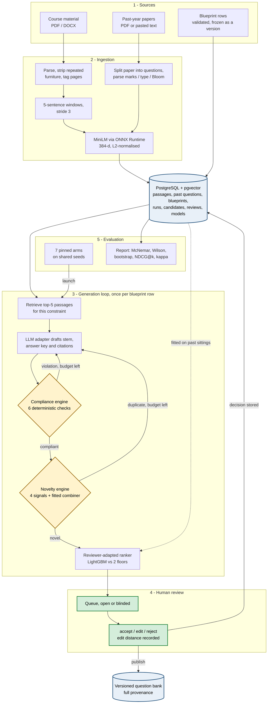

<p align="center">
  <h1 align="center">Assessment-Quality Platform</h1>
  <p align="center">
    <strong>Blueprint-compliant, source-grounded exam question generation — audited for constraint compliance and novelty, ranked by learned reviewer preference, and evaluated against pinned baselines with interval-carrying metrics.</strong>
  </p>
  <p align="center">
    
    
    
    
    
    
    
  </p>
</p>

---

## Overview

Faculty set exam papers by hand. Each question must map to a course outcome, sit at the right Bloom level, carry the right marks, be answerable from what was taught, and not repeat a past paper — and today all of that is verified from memory.

Generic AI tools (ChatGPT, NotebookLM, plain RAG) write fluent questions but guarantee none of those properties. They do not check a blueprint, do not compare against institutional past papers, and do not learn from reviewer decisions.

This platform generates questions **under explicit constraints** and **audits every draft before a human sees it**. A coordinator freezes a versioned blueprint; the system retrieves passages from the uploaded course material, drafts a candidate through a swappable LLM backend, runs a deterministic compliance engine against every blueprint field, scores the draft against the past-year corpus on four independent signals, redrafts whatever fails, and presents the survivors to reviewers with citations, page references, a pass/fail checklist and the novelty breakdown. Every reviewer decision is recorded and becomes training data for the ranker; every published question carries full provenance.

> **Key differentiator:** no part of the audit is the generating model's own opinion. Compliance is rule-based and auditable, grounding is verified verbatim against the source, novelty is a fitted model over four signals whose per-signal weight is reported, and the ranker ships only if it beats two floors on held-out review sittings.

All four engines of [`plan.md`](plan.md) are implemented. What remains is institutional data — real past-year papers and real reviewer sittings — which the roadmap at the end of this file sets out.

---

## System Architecture



Shaded in amber are the two audits that run before any human sees a draft; in green, the only points where a person decides. A failure at either audit returns the draft to the model with the exact failures named, until the repair budget is spent.

### Blueprint compliance

Each draft is checked against the blueprint row it was generated for. Every check is a fixed rule over the text:

| Check | Rule |
|---|---|
| `bloom_level` | Cue-verb classifier on the stem (earliest cue wins, ties go higher) must equal the constraint level |
| `question_type` | MCQ needs exactly 4 options with the answer among them; non-MCQ must have none; numerical needs numbers in stem and answer |
| `marks` | Answer-key word count must fall in the band for the mark weighting |
| `concept` / `course_outcome` | Content words of the constraint must appear in the question or answer |
| `grounding` | At least one citation whose quoted text is **verbatim** in the cited passage and whose support score clears the floor |

$$\text{satisfaction rate} = \frac{\text{checks passed}}{\text{checks run}}$$

The first-draft report is preserved through every repair, so the pre-repair satisfaction rate stays measurable.

### Novelty auditing

A candidate is compared against every past-year question of the course on four independent signals, each in $[0,1]$:

| Signal | What it catches |
|---|---|
| **semantic** | Embedding cosine similarity — the same question in different words |
| **lexical** | Okapi BM25 term overlap, normalised by the query's self-score — copied phrasing |
| **structural** | Type, marks, Bloom level, and the clause **set** after trimming shared lead-in wording — conditions reordered |
| **numerical** | Token similarity after masking every number — a question reused with new numbers |

A logistic regression combines them into one duplicate probability:

$$P(\text{duplicate}) = \sigma\Big(\beta_0 + \sum_{s \in \{\text{sem},\text{lex},\text{str},\text{num}\}} \beta_s \cdot x_s\Big)$$

Logistic regression is used rather than a learned ensemble because $\beta_s$ is directly reportable. The fitted model is four coefficients, an intercept and a threshold, stored as JSON — diffable and reviewable. Plan §3.1 names a single embedding threshold as the method this must beat, and the held-out evaluation reports both side by side.

### Reviewer-adapted ranker

Every accept, edit and reject is stored with reviewer, edited text, normalised edit distance and reason. A LightGBM classifier is fitted on **pre-review features only** — compliance scores, novelty signals, grounding, Bloom level, marks, lengths — and used to order future candidates.

$$\text{NDCG@}k = \frac{\sum_{i=1}^{k} \frac{2^{rel_i}-1}{\log_2(i+1)}}{\text{IDCG@}k}, \qquad rel = \begin{cases} 2 & \text{accepted as-is} \\ 1 & \text{edited} \\ 0 & \text{rejected} \end{cases}$$

Models are compared by leave-one-session-out cross-validation, holding out a whole review sitting at a time. **LightGBM ships only if it beats both floors** — a logistic regression over the same features, and a compliance-score-only ranking. Otherwise the simpler model ships and that result is recorded.

### Evaluation protocol

Seven pinned arms run against the same frozen blueprint under the same seeds:

| Arm | Retrieval | Blueprint stated | Compliance enforced | Novelty enforced | Ranked |
|---|---|---|---|---|---|
| `full_system` | passages | yes | yes | yes | ranker |
| `plain_llm` | none | no | no | no | no |
| `source_grounded` | whole material | no | no | no | no |
| `fixed_prompt_rag` | passages | no | no | no | no |
| `ablation_no_blueprint` | passages | yes | **no** | yes | ranker |
| `ablation_no_novelty` | passages | yes | yes | **no** | ranker |
| `ablation_no_ranker` | passages | yes | yes | yes | **compliance order** |

Measurement is never switched off — every arm's drafts are still checked and audited, so each has a satisfaction rate and a duplicate rate. What an arm changes is whether a failure sends the draft back. Reviewers judge through a **blinded queue**: questions from all arms shuffled together, order seeded per reviewer, with neither the arm label nor the run id in the response.

---

## Results

### Verification

| What | Result |
|---|---|
| Automated tests | **66 passing** — unit tests for every signal, the split rule, the metrics and the selection rule; pipeline tests for ingestion → generation → audit → review → publish, the novelty engine, the ranker, and the evaluation harness |
| Live run on real course material | 26-page *Data Flow Diagrams* deck → 42 passages, 26/26 pages covered; 6 candidates in 6 min 40 s on a local 8B model; 4/6 compliant, violations caught on `bloom_level`, `marks` and `grounding` |
| Embedding backend swap | ONNX vectors **bit-identical** to the previous PyTorch vectors across stored chunks (max elementwise difference 0.0) |
| Novelty engine on real data | 15-question demo paper → 72 labelled pairs → fitted combiner, held-out evaluation run |

### The novelty result is not yet a claim

On the current 14-pair test fold the four-signal combiner scores precision, recall and F1 of 1.000 with interval [1.000, 1.000] — **and so does the single embedding threshold it is supposed to beat**. Both separate the data perfectly, so this measures nothing about the engine.

That is the situation plan §5 predicts: 72 pairs built from 15 questions is far below the 300-pair floor, and transformed variants of distinct questions are not hard enough negatives. The honest reading is that the engine is **mechanically verified and statistically untested**. Two things change it, both needing institutional data:

1. **Real past papers across two or more years**, which contain genuinely near-duplicate questions on the same concept — the cases a cosine threshold gets wrong.
2. **At least 300 labelled pairs**, so the 20% test fold holds 60+ and a bootstrap interval on F1 is narrower than ±0.10.

The strong regularisation the fit selected (C = 0.01, weights 0.03–0.07) is the same symptom: at this sample size every setting ties on validation, so the selection is uninformative rather than wrong. The model card reports the C and the fold sizes so this is visible rather than buried.

---

## Innovation Layer

| Component | What It Does | File |
|---|---|---|
| **Blueprint Compliance Engine** | Six deterministic checks per draft, violations named by field / expected / observed; repair loop re-prompts with the exact failures. The model never grades itself. | `backend/app/services/compliance.py` |
| **Multi-signal Novelty Engine** | Four signals scored against the past-year corpus, combined by a logistic regression whose weights are reported; duplicates are redrafted with the repeated question named. | `backend/app/services/novelty/` |
| **Labelled Pair Construction** | Duplicates built by renumbering, reordering conditions and substituting synonyms, so the label is known by construction; hard negatives mined as the nearest non-duplicates. | `backend/app/services/novelty/pairs.py` |
| **Immutable Split Rule** | A pair's fold is `hash(seed, pair_key)`, depending on nothing else, so adding pairs can never move an existing one and a split cannot be silently re-drawn. | `backend/app/services/novelty/dataset.py` |
| **Reviewer-adapted Ranker** | LightGBM over pre-review features only, selected against two floors by leave-one-session-out NDCG@k. | `backend/app/services/ranker/` |
| **Evaluation Harness** | Seven pinned arms × seeds on one frozen blueprint, blinded review queue, and a report where every figure carries a Wilson or bootstrap interval. | `backend/app/services/evaluation/` |
| **Verified Grounding** | Each citation stores the quoted character span and a cosine support score; a paraphrased or invented quote counts as no grounding. | `backend/app/services/orchestrator.py` |
| **Swappable LLM Backend** | One adapter interface; self-hosted Ollama (temperature and seed honoured) and hosted Anthropic. Backend, prompt hash, temperature and seed logged per run. | `backend/app/llm/` |

---

## Repository Structure

```text
├── plan.md                              # Project plan: scope, evaluation protocol, schema, roadmap
├── docs/Project_Report.pdf              # Prototype report
├── backend/
│   ├── requirements.txt
│   ├── scripts/fetch_embedding_model.py # One-time ONNX model download
│   ├── data/models/                     # ONNX embedder, fitted combiner, fitted ranker (JSON)
│   ├── app/
│   │   ├── main.py  config.py  db.py  models.py  schemas.py  auth.py
│   │   ├── routers/                     # auth, materials, pyqs, blueprints, runs,
│   │   │                                #   reviews, bank, novelty, evaluation
│   │   ├── services/
│   │   │   ├── ingestion.py             #   PDF/DOCX -> sentence windows -> embeddings
│   │   │   ├── pyq_ingestion.py         #   past paper -> individual questions + metadata
│   │   │   ├── embeddings.py            #   ONNX Runtime MiniLM, 384-d, L2-normalised
│   │   │   ├── retrieval.py             #   pgvector similarity search
│   │   │   ├── compliance.py            #   rule-based blueprint checks + Bloom classifier
│   │   │   ├── orchestrator.py          #   retrieve -> draft -> audit -> repair, per arm
│   │   │   ├── review.py                #   normalised Levenshtein distance
│   │   │   ├── metrics.py               #   bootstrap, Wilson, McNemar, kappa, NDCG
│   │   │   ├── novelty/                 #   signals, combiner, pairs, dataset, training
│   │   │   ├── ranker/                  #   features, models, training
│   │   │   └── evaluation/              #   arms, harness, report
│   └── tests/                           # 66 tests: unit + four pipeline suites
└── frontend/src/                        # React: 5-step journey + Engines + Evaluation
    ├── pages/                           #   Materials, Blueprints, Generate, Review, Bank,
    │                                    #   Engines, Evaluation, Login
    └── components/                      #   Candidate (with blinded mode), Stats
```

---

## Quick Start

### 1. Prerequisites

| Needed | Version / note |
|---|---|
| PostgreSQL + [pgvector](https://github.com/pgvector/pgvector) | 18 with pgvector 0.8.6; the `vector` extension itself is created by the app at startup |
| Python | 3.14 |
| Node | 24 |
| LLM backend | [Ollama](https://ollama.com) with a pulled model (default `qwen3:8b`) **or** an `ANTHROPIC_API_KEY` |

### 2. One-time install

```powershell
# from the repository root
copy .env.example backend\.env           # then set LLM_BACKEND / OLLAMA_MODEL or ANTHROPIC_API_KEY

cd backend
python -m venv .venv
.\.venv\Scripts\activate
pip install -r requirements.txt
python scripts\fetch_embedding_model.py  # one-time, ~90 MB ONNX embedder into data/models/

cd ..\frontend
npm install
```

On macOS or Linux the activate line is `source .venv/bin/activate`; everything else is identical.

Create the two databases. Tables, the `vector` extension and the seed users are all created on first backend start, so nothing else is needed here:

```powershell
psql -U postgres -c "CREATE DATABASE aqp"
psql -U postgres -c "CREATE DATABASE aqp_test"
```

No PyTorch: embeddings run on ONNX Runtime, which keeps the install small and every native binary signed.

---

## Running the Project

Four things have to be up — PostgreSQL, the LLM backend, the API and the dev server. The first two are services that survive a reboot; the last two each hold a terminal.

### 1. PostgreSQL

```powershell
Get-Service postgresql*                   # expect Status: Running
Start-Service postgresql-x64-18           # only if it is stopped
```

### 2. LLM backend

```powershell
ollama list                               # expect qwen3:8b in the list
ollama pull qwen3:8b                      # first time only
```

On Windows the Ollama desktop app keeps the server on `http://localhost:11434`; without it, run `ollama serve` in its own terminal. Skip this step entirely when `LLM_BACKEND=anthropic`.

### 3. Backend API — terminal 1

```powershell
cd backend
.\.venv\Scripts\activate
uvicorn app.main:app --reload --port 8000
```

### 4. Frontend — terminal 2

```powershell
cd frontend
npm run dev
```

### Where everything is

| | URL |
|---|---|
| App | http://localhost:5173 |
| API docs (OpenAPI, every endpoint callable) | http://localhost:8000/docs |
| Ollama | http://localhost:11434 |

### Sign in

With `DEV_LOGIN=true` three users are seeded on first start and the email alone logs you in:

| Email | Role | What it can do |
|---|---|---|
| `coordinator@example.edu` | coordinator | upload material and past papers, edit and freeze blueprints, fit the engines, launch a study, reveal arm labels |
| `reviewer1@example.edu` | reviewer | generate, review, publish |
| `reviewer2@example.edu` | reviewer | the second rater, for the inter-rater kappa |

Set `OIDC_ISSUER` and institutional SSO replaces this; turn `DEV_LOGIN` off when it does.

### The journey

1. **Upload sources** — course material (what questions are written from) and past-year papers (what they are checked against).
2. **Define blueprint** — add rows, validate, freeze as a version.
3. **Generate** — retrieve, draft, compliance audit, novelty audit, rank.
4. **Review** — six-check tiles, draft history, highlighted source passages, novelty breakdown; accept / edit / reject; publish.
5. **Question bank** — published questions with readable provenance.

**Engines** builds the labelled pair set, fits the novelty combiner and the ranker, and shows their model cards. **Evaluation** launches the arms, serves the blinded queue and renders the report.

### Tests

```powershell
cd backend
.\.venv\Scripts\python -m pytest -q                              # 66 tests
.\.venv\Scripts\python -m pytest -q tests\test_novelty_signals.py  # one suite
```

Tests run against `aqp_test` with their own model paths and a stubbed LLM, so a test run never touches the `aqp` database or the fitted models the app serves.

### Stopping

`Ctrl-C` in each terminal. PostgreSQL and Ollama stay up as services.

### If something will not start

| Symptom | Cause |
|---|---|
| `connection refused` on 5432 | PostgreSQL service is stopped — step 1 |
| `extension "vector" is not available` | pgvector is not built into this PostgreSQL installation |
| `FileNotFoundError: ...all-MiniLM-L6-v2-onnx/model.onnx` | `python scripts\fetch_embedding_model.py` has not been run |
| `connection refused` on 11434 | Ollama is not running — step 2 |
| Generation sits for minutes | expected: `qwen3:8b` on CPU takes 1-2 min per draft, and `ollama_timeout` allows 900 s |
| An application control policy blocks a DLL | this stack is deliberately free of PyTorch and PyMuPDF for exactly that reason; do not add them back |

---

## Deploying it (free)

Everything below has a free tier that needs no card. The backend is a Dockerfile, so the same image
runs on Render or on a Hugging Face Docker Space — note that Spaces running on compute now require
a paid plan, so Render is the free path.

| Layer | Service | Limit that matters |
|---|---|---|
| Frontend | Cloudflare Pages | none for a static build |
| Backend | Render free web service | 512 MB RAM, sleeps after 15 min idle |
| Database | Neon free Postgres | pgvector available, scale-to-zero |
| LLM, primary | your own machine over a Cloudflare tunnel | only up when the machine is |
| LLM, fallback | Groq free tier | per-model daily caps |

### 1. Database

Create a Neon project, then run `CREATE EXTENSION IF NOT EXISTS vector;` once. Take the connection
string and change the scheme to `postgresql+psycopg://`.

### 2. Google sign-in

In Google Cloud Console: new project, OAuth consent screen, then **Credentials → OAuth client ID →
Web application**. Authorized redirect URIs:

```
https://<your-backend>.onrender.com/auth/callback
http://localhost:8000/auth/callback
```

Choose **Internal** on the consent screen if your Workspace allows it — Google then restricts
sign-in to the organisation itself. If only **External** is available, the app stays in testing mode
and you add reviewers as test users (up to 100). The scopes used are `openid email profile`, which
do not require Google's app verification.

### 3. Backend on Render

**New → Blueprint**, pick the repository, and Render reads `render.yaml`: runtime Docker, free
plan, and a prompt for each variable marked `sync: false`. (**New → Web Service** works too —
choose runtime *Docker*, Dockerfile path `./Dockerfile`, plan *Free*, and set the variables by
hand.) `SESSION_SECRET` is generated for you.

| Variable | Value |
|---|---|
| `DATABASE_URL` | the Neon string, scheme changed to `postgresql+psycopg://` |
| `OIDC_CLIENT_ID` / `OIDC_CLIENT_SECRET` | from step 2 |
| `OIDC_REDIRECT_URI` | `https://<service>.onrender.com/auth/callback` |
| `COORDINATOR_EMAILS` | your institute address — this is how you become coordinator |
| `COURSE_CODE` / `COURSE_TITLE` | the course this instance serves |
| `FRONTEND_URL` | the Pages URL — not known yet, see below |
| `DEV_LOGIN` | `false`; leaving it on would hand a session to anyone who knows a seeded address |

The first build takes several minutes: it installs the dependencies and bakes the embedding model
into the image.

Two values can only be filled in after the other service exists, so this is a two-pass step:

1. Deploy Render with `FRONTEND_URL` set to anything (the service URL itself will do).
2. Take the service URL, add `https://<service>.onrender.com/auth/callback` to the Google client's
   authorized redirect URIs, and set `OIDC_REDIRECT_URI` to the same string. **Exact match** — a
   mismatch is rejected by Google before the account picker appears.
3. Deploy Pages (step 4), then come back and set `FRONTEND_URL` to the Pages URL. Render redeploys
   on save.

### 4. Frontend on Cloudflare Pages

Root directory `frontend`, build `npm run build`, output `dist`, and one variable:
`VITE_API_BASE=https://<service>.onrender.com`.

### First sign-in

Open the Pages URL, sign in with the address in `COORDINATOR_EMAILS`, and you land as coordinator.
Everyone else who signs in appears on the **People** screen as `pending` until you grant them a
role.

### 5. Self-hosted model, optional

Run `cloudflared` on your machine pointing at `localhost:11434`, put **Cloudflare Access** in front
with a service token, and set `OLLAMA_URL`, `CF_ACCESS_CLIENT_ID` and `CF_ACCESS_CLIENT_SECRET` on
Render. With `LLM_BACKEND=failover` the backend probes the tunnel when a run starts: reachable means
your own model, unreachable means Groq. Leave Ollama bound to localhost — `cloudflared` reaches it
from the same machine, and Ollama itself has no authentication.

### Who can do what

The site is public; sign-in is not. Three checks run server-side on the callback — the address is
verified, the Workspace domain claim matches `ALLOWED_DOMAIN`, and the address ends in that domain.
A `hd=` hint on the authorization URL only filters Google's account picker, so it is never trusted
on its own.

With the Google app configured as **Internal**, Google refuses non-organisation accounts before the
callback is reached at all ("can only be used within its organisation"), so those checks are a
second line rather than the first. They become the only line if the consent screen is ever switched
to External — as does `ALLOWED_EMAILS`, which an Internal app makes unreachable.

A first sign-in creates the account with role **pending**, which satisfies no role check anywhere:
the person is authenticated and can see nothing. A coordinator grants **reviewer** on the People
screen. That gate is not ceremony — review decisions are the ranker's training data and the input to
the inter-rater agreement figure, so a decision recorded by someone outside the study changes a
reported number.

### Two things not to do

**Do not run the evaluation study on free hosting.** Seven arms by three seeds is hours of
generation; an instance that sleeps or restarts loses the run.

**Do not let a study fall back.** The arms are comparable only because the model and prompt are
pinned. Set `LLM_BACKEND` explicitly for a study and let it fail rather than switch — a run that
started on one backend always finishes on it, but the choice across runs must not drift.

---

## Methodology

### Ingestion & retrieval
- **Parsing:** pypdf (PDF, page-tagged), python-docx (Word, paragraph-tagged)
- **Chunking:** 5-sentence windows, stride 3; bullets and line breaks act as sentence boundaries; wrapped lines re-joined; lines repeating on ≥50% of pages removed as furniture
- **Embeddings:** all-MiniLM-L6-v2 via ONNX Runtime — mean-pooled under the attention mask, L2-normalised, `VECTOR(384)`
- **Retrieval:** cosine distance in pgvector, top-5 per constraint, query = `"{concept}. {course_outcome}"`

### Past-year corpus
Rule-based splitting on question numbering (`1.`, `Q1`, `1 a)`, `(a)`, `iii)`) with marks parsed off the stem; type and Bloom level inferred for the structural signal. Papers whose layout defeats the splitter can be pasted as text, and the extraction is shown back for checking before it is used.

### Protocol guarantees in code
- Fold assignment is a pure function of the pair and the committed seed — **adding pairs never moves an existing pair**
- Training reads the train and validation folds only; the **test fold is behind its own endpoint** and every access is counted and reported
- Ranker features are listed explicitly and asserted leakage-free in tests
- Undefined statistics serialise as `null`, never as `0` or `NaN`
- A difference whose interval includes zero is reported as *no significant difference*

### Reproducibility
`generation_runs` stores backend id, prompt hash, temperature, seed and arm label. Ollama honours temperature and seed; the Anthropic adapter logs both as `NULL` because current Claude models reject sampling parameters and the API has no seed — a value the backend did not honour is never recorded.

---

## Tech Stack

| Layer | Technology |
|---|---|
| Backend API | FastAPI, SQLAlchemy 2, psycopg 3 |
| Database | PostgreSQL 18 + pgvector 0.8.6 |
| Parsing | pypdf, python-docx |
| Embeddings | ONNX Runtime + HuggingFace tokenizers (all-MiniLM-L6-v2) |
| Models | scikit-learn (logistic regression), LightGBM (ranker) |
| Statistics | Bootstrap, Wilson score, exact McNemar, Cohen's kappa, NDCG — implemented in `services/metrics.py` |
| LLM | Ollama (qwen3:8b) · Anthropic SDK, behind one adapter interface |
| Frontend | React 19, Vite |
| Tests | pytest + FastAPI TestClient against real PostgreSQL |

---

## Roadmap

The code for every engine is in place. What it needs now is data.

1. **Real past-year papers**, two years or more, replacing the demo paper currently in the database.
2. **300+ labelled pairs**, so the novelty engine's held-out numbers can distinguish it from the single-threshold baseline.
3. **Reviewer sittings** — at least three per course before the ranker's comparison means anything.
4. **A blinded evaluation study** across all seven arms with three seeds, then the report.
5. **Human citation judgement** on the 50-citation sample the report already draws.
6. **Alembic**, once the evaluation data matters, replacing the startup schema patches in `db.py`.
7. **Qualitative failure analysis** (plan §13.2): the hardest true positive, the most instructive false positive and false negative, per engine.

---

## License
This project is for academic purposes. Course material uploaded to the platform remains the property of its authors.
